# Azure Functions Agent Runtime architecture

## 1. Overview

`azure-functions-agents-runtime` turns a markdown-first agent project into an enhanced `azure.functions.FunctionApp` or Durable `DFApp`. The design goal is that you write `.agent.md` files plus a small amount of supporting configuration, and the runtime translates that authoring format into Azure Functions triggers, HTTP routes, MCP surfaces, tool wiring, and catalog-backed `HostedSkill` injection for ordinary Functions. At startup, the runtime follows a three-stage pipeline: **discover** project files and inventories, **translate** them into typed runtime objects, and **register** the resulting agents on a Function App. The default entry point remains `create_function_app()`; the additive `HostedSkillFunctionApp()` constructor delegates to the same authoritative implementation in `src/azure_functions_agents/app.py:_compose_function_app()`.

One agent can also declare a `subagents:` list so its own model can call other agents as `delegate_<slug>` tools during a normal `agent.run()` — chat-time multi-agent delegation (FRD 0007). That feature layers a small amount of extra structure onto the same pipeline (an app-wide identity index and an immutable, slug-keyed catalog built before any `FunctionApp` mutation) rather than introducing a new one; see Section 5, "Multi-agent delegation (subagents)".

Agent evaluation is external and cross-cutting rather than a startup pipeline stage. The preview
Vally executor invokes the existing synchronous chat route under Core Tools or in staging and
translates generic response/tool evidence into a Vally trajectory. Vally owns stimuli, graders,
repeated trials, scores, reports and CI verdicts; the executor does not add a second discovery,
composition, registration or execution path (FRD 0010).

## 2. High-level data flow

```mermaid
flowchart LR
    A["Agent project inputs<br/>*.agent.md / agent.md / CLAUDE.md / *.claude.md<br/>agents.config.yaml<br/>mcp.json<br/>skills/<br/>tools/"] -->|"Path"| B["config/paths.py"]
    B -->|"app_root: Path"| C["config/loader.py<br/>load_global_config<br/>load_agent_specs"]
    A -->|"Path"| D["discovery/*<br/>skills + tools + MCP"]
    C -->|"GlobalConfig + list of AgentSpec"| E["config/merge.py<br/>compose"]
    D -->|"discovered inventories"| E
    E -->|"list of ResolvedAgent"| E2["app.py<br/>identity index<br/>fail-fast on duplicate slugs"]
    E2 -->|"ResolvedAgent + known_slugs"| F["config/validation.py<br/>validate_resolved_agent<br/>validate_subagent_references"]
    F -->|"ResolvedAgent"| G["registration/capabilities.py<br/>build_capabilities"]
    G -->|"AgentCapabilities"| G2["registration/catalog.py<br/>AgentCatalog (immutable)"]
    G2 -->|"complete agent inventory"| W["workflows/integration.py<br/>handler catalog + workflow-agent policy catalog<br/>(immutable)"]
    W -->|"any workflow agent?"| I["FunctionApp or DFApp"]
    W -->|"register Durable runtime once"| I
    G2 -->|"AgentCatalog"| H["registration/triggers.py<br/>registration/endpoints.py"]
    W -->|"workflow-agent policy by slug"| H
    H -->|"Decorators applied"| I
    G2 -->|"AgentCatalog"| HS["_hosted_skill_app.py<br/>hosted_skill decorator"]
    HS -->|"HostedSkill facade per invocation"| I
    B -->|"once-per-app selection"| HB["harness/_harness_binding.py<br/>AppHarness + HarnessRequest"]
    HB -.->|"bound construction"| R["harness/_agent_runner.py<br/>AgentRunner contract + per-app cache"]
    K["runner.py<br/>public host policy + neutral request factory"] -.->|"timed execution inputs"| R
    J["harness/_provider_config.py<br/>neutral provider/model target"] -.->|"resolved target"| MR["harness/agent_framework/_maf_runner.py"]
    MR -.->|"MAF client"| L["harness/agent_framework/_maf_execution.py<br/>Microsoft Agent Framework"]
    H -.->|"handler closures + AgentCatalog"| K
    R -.->|"MafRunner"| MR["harness/agent_framework/_maf_runner.py"]
    MR -.->|"neutral HarnessRequest"| L
    L -.->|"MAF-owned history"| T["harness/agent_framework/<br/>_maf_blob_history.py / _maf_file_history.py<br/>JSONL transcripts"]
    R -.->|"CopilotRunner"| CR["harness/copilot_sdk/_copilot_runner.py"]
    CR -.->|"neutral HarnessRequest: explicit preview"| P["harness/copilot_sdk/<br/>_copilot_execution.py + _copilot_runtime.py<br/>Copilot SDK + native stdio"]
    P -.->|"SDK SessionFs callbacks"| S["harness/copilot_sdk/_copilot_session_fs.py<br/>opaque SDK files<br/>local files or one Blob per file"]
```



Read left to right: files on disk become typed config, typed config becomes a
`ResolvedAgent`, and each resolved agent is registered as Azure Functions
bindings plus optional built-in endpoints. Before registration, startup freezes
the complete `AgentCatalog`, complete workflow-handler catalog, and immutable
workflow-agent policy catalog. This makes both delegation and per-agent workflow
authorization independent of file order.

A few boundaries are worth calling out explicitly:

- **Discovery is read-only.** These modules inspect the project tree and return inventories; they do not decide what any one agent is allowed to use or create SDK clients, live tokens, or MCP connections.
- **Capabilities are harness-neutral.** Authored callables become SDK-free runtime tool descriptors before either harness adapts them. MCP servers and skills are also discovered and filtered before SDK construction.
- **Translation is type-driven.** The loader and merge layers convert loose YAML/markdown input into `AgentSpec`, `GlobalConfig`, and then `ResolvedAgent`.
- **Composition is two-pass and side-effect-free until pass 2.** `app.py` builds
  the slug index and validates references, then
  freezes the `AgentCatalog`, complete workflow-handler catalog, and per-agent
  workflow-policy catalog. Only pass 2 creates/mutates the app, registers the
  workflow runtime once, and registers agent surfaces (FRDs 0004 and 0007).
- **Registration is Azure-specific.** This is the first stage that knows about `azure.functions.FunctionApp`, decorators, routes, and trigger bindings.
- **Resource acquisition is deferred.** A cheap selected runner can qualify configuration before registration. Its constructor imports no SDK and acquires no credentials, client, native process, or filesystem. Actual execution and history projection remain deferred to requests. Each harness owns its persistence implementation; Copilot's SDK owns session behavior and uses the host's thin filesystem callbacks.

## 3. Module map

| Package/module | Role | Key entry points |
| --- | --- | --- |
| `azure_functions_agents/app.py` | Top-level two-pass composition root. Before app mutation it builds the slug index, `AgentCatalog`, complete workflow-handler catalog, and immutable workflow-agent policy catalog. It chooses the internal Durable app when any agent enables workflows and the normal app otherwise, registers the workflow runtime once, then registers each agent. The default factory and additive constructor delegate to the same private composition function. | `create_function_app()`, `HostedSkillFunctionApp()`, `HostedSkillApp`, `_compose_function_app()`, `_fail_on_duplicate_slugs()` |
| `azure_functions_agents/_hosted_skill_app.py` | Defines the internal enhanced normal and Durable app implementations. Its decorator selects a catalog entry by slug, applies common capability checks plus MAF-only provider preflight, hides the injected parameter from worker indexing, and creates a fresh facade per Function invocation. Copilot qualification remains owned by app selection and catalog validation. | `hosted_skill()` |
| `azure_functions_agents/hosted_skill_binding.py` | Implements the harness-neutral application facade. Each explicit `run()` or `stream()` call resolves a public session ID, binds per-session sandbox tools, copies mutable capability lists, and delegates resource ownership to the runner. | `HostedSkill.run()`, `HostedSkill.stream()` |
| `azure_functions_agents/_agent_validation.py` | Owns dependency-free validation shared by the runner, endpoint layer, HostedSkill binding, and session storage identity. | `validate_prompt()`, `validate_session_id()`, `SESSION_ID_PATTERN` |
| `azure_functions_agents/_agent_run_diagnostics.py` | Owns SDK-, harness-, and Azure-independent run diagnostics shared by registered handlers, built-in endpoints, HostedSkill, and both harness adapters: the canonical run span, tool-error accounting, and run-summary telemetry. | `start_agent_run_span()`, `_set_run_result_attributes()`, `_total_tool_error_count()` |
| `azure_functions_agents/streaming_events.py`, `response_contract.py` | Own the harness-neutral typed stream vocabulary and payload conversion, plus the shared structured-response instruction/validation contract used by HTTP handlers and HostedSkill. The HostedSkill event names are runtime aliases of the neutral owning classes; HTTP transport serialization stays in the public runner. | `AgentStreamEvent`, `AgentStreamEventKind`, `HostedSkillEvent`, `HostedSkillEventKind`, `validate_response_contract()` |
| `azure_functions_agents/config/paths.py` | Resolves the app root and the optional config/history directory. | `set_app_root()`, `get_app_root()`, `resolve_config_dir()` |
| `azure_functions_agents/config/env.py` | Performs env-var substitution and bool coercion across config string values in YAML, JSON, front matter, and markdown body content. | `substitute_env_vars_in_value()`, `resolve_env_vars_in_data()`, `substitute_env_vars_in_text()`, `_to_bool()` |
| `azure_functions_agents/config/schema.py` | Defines the Pydantic models for raw, global, and merged config, including independent object-only chat and workflow Sub Agent grants. | `AgentSpec`, `GlobalConfig`, `ResolvedAgent`, `TriggerSpec`, `BuiltinEndpointsConfig`, `SubagentRef`, `WorkflowConfig`, `WorkflowSubagentRef` |
| `azure_functions_agents/config/loader.py` | Discovers supported agent markdown filenames and loads YAML front matter and `agents.config.yaml` into typed models while preserving real source paths. | `load_agent_specs()`, `load_global_config()` |
| `azure_functions_agents/config/merge.py` | Applies defaults, overrides, and per-agent filters to produce runtime config, including each agent's identity `slug` (via `_slug.py`) and its normalized `subagents` list. | `compose()` |
| `azure_functions_agents/_slug.py` | Owns recognized prefixed agent suffixes and derives identity slugs from their filename prefixes (plus the `delegate_<slug>` tool-name convention), so discovery, naming, config composition, and delegation cannot drift. | `_prefixed_agent_file_suffix()`, `_function_name_from_source()`, `delegate_tool_name()` |
| `azure_functions_agents/_runtime_tool_names.py` | Dependency-free canonical `fhs_` names for the five workflow-management tools and sandbox execution. Shared by prompts, collision checks, and workflow restrictions. | `RUNTIME_WORKFLOW_TOOL_NAMES`, `FHS_EXECUTE_PYTHON_TOOL_NAME` |
| `azure_functions_agents/_agent_identity.py` | Sole shared identity authority: trimmed, lower-case `WEBSITE_SITE_NAME` (or `local`) plus canonical slug. MAF and Copilot consume this helper unchanged; owner/deployment metadata does not affect it. | `agent_id()` |
| `azure_functions_agents/harness/_history_identity.py` | Shared SDK-free canonical slug validation, consumed by both selected implementations. | `validate_agent_slug()` |
| `azure_functions_agents/harness/agent_framework/_maf_blob_history.py`, `_maf_file_history.py` | Preserve MAF JSONL history by agent/session identity. Imported and used only on the MAF path; acquired Blob clients and owned credentials register their shutdown callback. | `BlobHistoryProvider`, `ScopedFileHistoryProvider`, `_maf_blob_history.shutdown()` |
| `azure_functions_agents/harness/_session_storage.py` | Harness-neutral Blob configuration, storage-specific identity/container precedence, sanitized backend errors, and owned service/credential construction. Does not import either persistence implementation. | `BlobStorageSettings`, `SessionStorageError`, `blob_storage_from_environment()`, `open_blob_service()` |
| `azure_functions_agents/harness/copilot_sdk/_copilot_session_identity.py` | SDK-independent, frozen Copilot storage routing and readable session prefixes, with unchanged shared agent identity and session/path validation. Resolved only when Copilot is selected. | `StorageRoute`, `StorageMode`, `resolve_route()`, `session_prefix()`, `CopilotSessionError` |
| `azure_functions_agents/config/validation.py` | Post-merge sanity checks for resolved agents, including rejecting unknown/duplicate/self references in both independent Sub Agent grants against the app-wide slug index. | `validate_resolved_agent()`, `validate_subagent_references()`, `validate_workflow_subagent_references()` |
| `azure_functions_agents/discovery/skills.py` | Finds canonical skill directory candidates through two child levels, stopping at `SKILL.md` roots. Directory basenames supply filter identities. Reads no skill content, imports no SDK, and preserves cached path inventories; the selected SDK owns metadata validation and loading. | `SkillDescriptor`, `discover_skills()`, `clear_skills_cache()` |
| `azure_functions_agents/discovery/tools.py` | Imports `tools/*.py`, selects the first named tool per module (preferring runtime descriptors) or the first local public function fallback, discovers explicit `@workflow_tool` Activity targets, and caches both inventories. No authored invocation or SDK-origin classification. | `discover_project_tools()`, `discover_user_tools()` |
| `azure_functions_agents/discovery/mcp.py` | Loads `mcp.json`, applies `resolve_env_vars_in_data()`, and emits immutable HTTP/streamable-HTTP server descriptors with repr-hidden static headers, tool filters, and optional Entra scope/client ID. No SDK clients or token acquisition. | `MCPServerDescriptor`, `discover_mcp_servers()` |
| `azure_functions_agents/registration/capabilities.py` | Applies per-agent MCP/skills/tools filters to neutral inventories; retains the complete discovered skill roots as ownership metadata, not access grants. Fails fast on derived `delegate_<slug>` collisions and on exact authored-name collisions with runtime tools enabled for that role. Unprefixed authored names stay independent. A shallow direct-role copy may add runtime-owned skills without mutating the project-only catalog. | `AgentCapabilities`, `build_capabilities()`, `with_runtime_skill_paths()`, `validate_subagent_tool_names()`, `validate_runtime_tool_name_collisions()` |
| `azure_functions_agents/registration/catalog.py` | Freezes every agent's `ResolvedAgent` + `AgentCapabilities` into one immutable, slug-keyed `AgentCatalog`, built once at startup and threaded read-only into request handlers (FRD 0007). | `AgentCatalog`, `CatalogEntry`, `build_catalog()` |
| `azure_functions_agents/registration/_naming.py` | Fails fast via `allocate_unique_function_name()` / `allocate_unique_builtin_slug()` when two `.agent.md` files sanitize to the same identity slug, instead of silently auto-suffixing. Re-exports the `_slug.py` helpers for backward compatibility. | `allocate_unique_function_name()`, `allocate_unique_builtin_slug()` |
| `azure_functions_agents/registration/_handlers.py` | Builds callable closures for trigger and HTTP requests, threads `AgentCatalog` through the runner, applies shared authorization, and combines tool-error accounting. Session-ID response policy is backend-neutral: always return caller-supplied IDs, and return generated IDs on failure only when the runtime confirms resumability. | `make_agent_handler()`, `make_http_agent_handler()`, `_total_tool_error_count()` |
| `azure_functions_agents/registration/_trigger_serialization.py` | Uses native data contracts and public Azure Functions binding adapters to produce JSON-safe non-HTTP trigger payloads. | `serialize_trigger_data()`, `TriggerBindingSerializer` |
| `azure_functions_agents/registration/triggers.py` | Registers each agent trigger, dispatching between the runtime HTTP adapter and Azure Functions trigger decorators. Resolves an `http_trigger`'s inbound auth (nested `auth`, deprecated flat `auth_level`) into the shared `EndpointAuthConfig` and applies the `_auth` route `AuthLevel`. | `register_agent()` |
| `azure_functions_agents/registration/endpoints.py` | Registers debug chat UI, REST chat, SSE streaming, and MCP tools; owns route, authorization, status, and history dispatch. The selected runner owns history availability and projection. | `register_builtin_endpoints()` |
| `azure_functions_agents/registration/_auth.py` | Enforces inbound endpoint auth: maps the configured `auth.mode` to a Functions `AuthLevel` (API key / anonymous) and enforces Entra ID identity by trusting the platform-validated Easy Auth `x-ms-client-principal` header (never validating tokens in-app), with optional tenant/audience/client-id allowlists. Because `entra` routes are anonymous, the header is trusted only with non-spoofable evidence Easy Auth is enforced (`WEBSITE_AUTH_ENABLED` / `AZURE_FUNCTIONS_AGENTS_ENTRA_EASY_AUTH`); fails closed (401) otherwise. | `resolve_endpoint_auth_level()`, `authorize_entra_request()` |
| `azure_functions_agents/system_tools/sandbox.py` | Builds and binds the ACA Dynamic Sessions-backed `fhs_execute_python` tool for a resolved agent/session, using a fresh GUID when no explicit session id is provided. | `create_sandbox_tools()`, `build_sandbox_tools_for_session()` |
| `azure_functions_agents/system_tools/web_request.py` | Builds the default-on, SSRF-guarded `web_request` outbound HTTP tool, built once per agent at registration (no Azure resource required). | `create_web_request_tools()` |
| `azure_functions_agents/runner.py` | Public result/defaults/signatures, role/delegate policy, compatibility hooks and the single SDK-free request factory. Computes deadlines before selection/preparation and forwards every execution entry point through the cached bound runner. `run_agent_events()` adapts the backend SSE vocabulary into typed events for `HostedSkill.stream()`. Keeps canonical `AgentResult` / `ToolCallEvidence`, including effective model and completed tool evidence. | `AgentResult`, `ToolCallEvidence`, `run_agent()`, `run_agent_events()`, `run_agent_stream()`, `build_subagent_tools()`, `run_leaf_agent_task()` |
| `azure_functions_agents/harness/_agent_runner.py` | One SDK-free private runner protocol for execution, history, optional configuration qualification, defaults, and observability policy. Caches the concrete selected runner under the binding's guard. No forwarding facade or separate adapter strategy. | `AgentRunner`, `get_agent_runner()` |
| `azure_functions_agents/harness/_provider_config.py` | SDK-neutral provider/model target resolution shared by selected harnesses; does not construct SDK clients or acquire credentials. | `InferenceTarget`, `resolve_inference_target()` |
| `azure_functions_agents/harness/agent_framework/_maf_runner.py` | Resource-free MAF runner with local default/history/observability policy. Uses the canonical request factory and bound app root, forwards approved skills, enables instrumentation at execution under the binding guard, and binds a shallow capability copy for leaf roles. | `MafRunner` |
| `azure_functions_agents/harness/agent_framework/_maf_client.py` | Constructs OpenAI, Azure OpenAI, and Foundry clients only for MAF, using the shared provider/model target. | `build_chat_client()` |
| `azure_functions_agents/harness/agent_framework/_maf_execution.py` | MAF role/session construction, neutral request adaptation, typed tool/MCP assembly, MAF-local usage decoding, non-streaming/streaming execution, event interpretation and teardown. Owns MAF-local helpers directly; retains top-level hooks only for shared result, session validation and role/delegate policy. Preserves stable IDs, readable names, provider options, shared expanded skill descriptors, history and leaf roles. | `assemble_agent_inputs()`, `run()`, `run_stream()`, `run_leaf_agent_task()` |
| `azure_functions_agents/harness/agent_framework/_maf_history.py` | Projects persisted MAF session messages into the common chat-history response contract; owns MAF history-provider construction and SDK message interpretation. | `get_session_history()` |
| `azure_functions_agents/harness/agent_framework/_maf_observability.py`, `_maf_warnings.py` | Keep MAF instrumentation and the two known experimental-warning suppressions (`create_harness_agent()`/`FileSystemAgentFileStore` and `FileHistoryProvider`) within MAF-owned operations; common startup does not import or initialize MAF telemetry. | `configure_maf_instrumentation()`, `suppress_experimental_warnings()` |
| `azure_functions_agents/harness/agent_framework/_maf_tools.py` | Adapts normalized runtime descriptors into MAF tools. Shared discovery and filtering do not interpret SDK objects. | `build_maf_tools()` |
| `azure_functions_agents/harness/agent_framework/_maf_mcp.py` | Lazily maps selected remote MCP descriptors to existing MAF HTTP wrappers, preserves SDK-owned origin-scoped header injection, and closes any SDK-created HTTP client when the transport lifecycle ends. | `build_maf_mcp_tools()` |
| `azure_functions_agents/_mcp_auth.py` | Shared SDK-free MCP header/auth boundary. Materializes fresh static headers for Copilot create/resume; supplies the existing cached outbound header provider for MAF. Preserves scope warnings, credential precedence, and generated `Authorization` without exposing secrets. | `materialize_mcp_headers()`, `build_mcp_header_provider()` |
| `azure_functions_agents/harness/_harness_execution.py` | One shared backend-neutral usage recorder plus the bounded process-local `(agent_slug, session_id)` lock implementation, consumed through module-qualified access by both harnesses. | `_AgentUsageRecorder`, `_session_lock_bounded_by()` |
| `azure_functions_agents/harness/_harness_binding.py` | Frozen SDK-free app identity, selected runner construction callable, neutral request, and selection vocabulary. Per-app selection is independent of the first-use standalone cache per root. A fresh guard/runner cache cell is allocated for every binding, including `dataclasses.replace` clones. Concrete provider/storage/runtime state and policy live only on selected runners. | `AppHarness`, `HarnessRequest`, `get_harness()`, `bind_harness()`, `validate_agent()` |
| `azure_functions_agents/harness/_harness_lifecycle.py` | Acquired-owner shutdown callbacks only; visits every registered owner even if cleanup fails, without backend discovery/imports. | `_register_shutdown()`, `_unregister_shutdown()`, `_shutdown_harnesses()` |
| `azure_functions_agents/harness/copilot_sdk/_copilot_providers.py` | Copilot provider interface, registry, sanitized settings and frozen OpenAI / Azure OpenAI / Foundry mappings. SDK provider config is built lazily. | `CopilotProvider`, `OpenAIProvider`, `AzureOpenAIProvider`, `FoundryProvider`, `_PROVIDERS` |
| `azure_functions_agents/harness/copilot_sdk/_copilot_runner.py` | Resource-free Copilot runner owning provider, storage, default model, history/observability policy, and the lazy native-owner reference. Qualifies preview configuration and composes direct, typed-event/SSE, delegate, and workflow-leaf operations using the shared request factory while preserving caller execution-surface telemetry. | `CopilotRunner` |
| `azure_functions_agents/harness/copilot_sdk/_copilot_execution.py` | Invocation-owned session and SessionFs create/resume, neutral custom/MCP/skill capabilities, conditional custom-only catalog validation, send-scoped synchronous `session.on`, result/usage translation, SSE event forwarding, isolated leaf-session cleanup, and bounded immediate teardown that preserves original failures/cancellation. Owns one semantic invocation from resolved request identity, before native session acquisition, through adapter cleanup. | `run()` |
| `azure_functions_agents/harness/copilot_sdk/_copilot_observability.py` | Copilot semantic `invoke_agent {readable-agent-name}` execution span and explicit tool-parent context; projects allowlisted usage and name-only skill events onto the owning runtime span, or semantic span for direct calls without one. Deduplicates usage observations without changing shared accounting. Shared `agent.run {slug}` naming and `af.agent.*` remain unchanged. Reuses the existing tracer/provider/export path without another subscription. | `invocation_span()`, `CopilotEventTelemetry`, `tool_span_attributes()` |
| `azure_functions_agents/harness/copilot_sdk/_copilot_capabilities.py` | Maps SDK-neutral capabilities into source-qualified availability, remote MCP configuration, individual approved skill directories/disabled names, and MCP-only/scoped-helper permissions. | Copilot capability projection |
| `azure_functions_agents/harness/copilot_sdk/_copilot_tool_calls.py` | Invocation-local native/custom tool-call arbitration, wrapper spans with explicit host context, matched native-only timed spans, and incomplete-telemetry diagnostics. Deduplicates wrapper records, preserves actual success/failure evidence, and redacts protected native headers without exporting envelopes. No result-origin restrictions. | `CopilotToolCalls`, `tool_result_text()` |
| `azure_functions_agents/_skill_policy.py` | SDK-free default-deny helper policy. Most-specific canonical discovered-root ownership permits only approved skill resources and narrow literal script invocations; excluded roots remain ownership metadata. Not an OS sandbox or skill-origin attestation. | `SkillPolicy` |
| `azure_functions_agents/harness/copilot_sdk/_copilot_runtime.py` | Lazy SDK stdio client and shared credential owner cached on the concrete Copilot runner. Owns the asynchronous startup lock and stable acquired-resource close callback. Bounded shutdown releases the runner's owner reference without changing selection or runner identity. No global owner map or deferred retry registry. | `CopilotRuntime`, `get_runtime()` |
| `azure_functions_agents/harness/copilot_sdk/_copilot_session_fs.py` | Actual SDK `SessionFsProvider` implementation for opaque files, with one route-based backend factory selection, callback serialization/deadlines, text conversion, SDK-shaped errors, and read-only projection of approved physical skill files. | `CopilotSessionFs`, `SessionFileBackend`, `open_session_fs()` |
| `azure_functions_agents/harness/copilot_sdk/_copilot_session_paths.py` | Selected Windows/POSIX callback path policies and independently selected physical-host policy; exact workspace mapping, lexical containment and local platform rules. Windows writes retain the host's binary-mode flag when available. | `SessionPathPolicy`, `select_session_path_policy()` |
| `azure_functions_agents/harness/copilot_sdk/_copilot_session_local.py`, `_copilot_session_blob.py` | Ordinary byte filesystem operations and flat-Blob filesystem adaptation, structurally conforming to the shared backend Protocol. Local birthtime uses the filesystem's creation timestamp when available, otherwise metadata-change time. No native-file interpretation or storage format changes. | `LocalSessionFileBackend`, `BlobSessionFileBackend` |
| `azure_functions_agents/__init__.py` | Public API exports and shutdown of acquired, harness-owned resources without importing unselected persistence implementations. | `shutdown_runtime()` |
| `azure_functions_agents/workflows/integration.py` | Builds the complete immutable handler catalog, immutable slug-keyed workflow-agent policy catalog (including allowed tools' decorator-owned retry and timeout declarations), per-agent management tools/addenda, validates declared trigger support for workflow-enabled agents, and performs the one app-wide Durable registration. It also resolves the packaged `data-driven-workflows` skill used for progressive authoring guidance. | `build_workflow_handler_catalog()`, `build_workflow_agent_policy_catalog()`, `build_workflow_agent_integration()`, `data_driven_workflows_skill_path()`, `validate_workflow_agent_trigger()`, `register_workflow_runtime()` |
| `azure_functions_agents/workflows/engine.py` | Registers one Durable blueprint per app and executes the native two-argument Durable Task orchestrator, workflow-tool Activity, and Workflow Sub Agent Activity. Orchestration and Activity schedules attach `durabletask.displayName` tags for readable DTS dashboard timelines without changing registered function names. Capability-bearing Activities reauthorize against the current workflow-agent policy before complete-catalog dispatch. Data-driven execution uses typed persisted-task/state contracts and deterministic phase helpers for `when` evaluation, bounded `for_each` materialization, runnable selection, ordered aggregation, result application, cancellation restoration, structured (`schema_version: 2`) status, and controlled-failure normalization. It selects retry and continuation behavior from persisted orchestration input. Static and dynamic schedulers share the continuation decision that commits bounded permitted failures. Waves without enabled continuation keep the earlier wait, failure, and cancellation order. Durable `yield` boundaries remain in the top-level orchestrator generator. | `register_workflows()` |
| `azure_functions_agents/workflows/context.py` | Tracks invocation context by `(workflow_agent_slug, session_id)`, derives non-revealing 128-bit agent/session prefixes for Durable instance IDs, and exposes the per-delivery task context whose idempotency key is stable across retry attempts. | `session_instance_prefix()`, `new_workflow_instance_id()`, `workflow_matches_agent_session()`, `current_workflow_task_context()` |
| `azure_functions_agents/workflows/activity.py` | Policy-aware Activity execution: strict validation of persisted retry, timeout, and continuation data; per-attempt deadline enforcement; the `ok`/`failure` outcome envelope; and the failure classification that decides whether Durable is asked to retry. Models read back from Durable history ignore unknown keys so a newer history still validates. | `invoke_policy_handler()`, `validate_activity_result()` |
| `azure_functions_agents/workflows/native_retry.py` | Maps the persisted retry policy onto Durable Python 2.x `RetryPolicy`, raises the private marker that asks Durable to retry a sanitized outcome, and decodes that outcome back out of an exhausted `TaskFailedError`. | `create_durable_retry_policy()`, `raise_for_durable_retry()`, `decode_durable_retry_failure()` |
| `azure_functions_agents/workflows/registry.py` | Defines immutable workflow handler entries/catalogs; production app composition passes this complete catalog explicitly rather than using the compatibility singleton allowlist as authorization. | `WorkflowHandlerCatalog`, `build_handler_catalog()` |
| `azure_functions_agents/workflows/schema.py`, `workflows/tools.py` | Define workflow plans and policies, including the data-driven `when` predicate, bounded `for_each`, plan-authored retry, timeout, and continuation, and per-field decorator precedence. Start-time validation freezes the effective execution policy into orchestration input. Continuation stays plan-only. List/status/cancel/terminate operations use the captured workflow-agent policy and agent/session identity. | `WorkflowPlanPolicy`, `WorkflowTaskExecution`, `WorkflowCondition`, `validate_plan()`, `resolve_workflow_task_execution()`, `build_workflow_tools()` |
| `azure_functions_agents/_tool_descriptor.py` | Frozen runtime tool schema, callable, execution policy, and workflow metadata, plus shared public-metadata readers. Runtime descriptors return fresh schemas and preserve Pydantic/top-level JSON argument behavior. | `ToolDescriptor`, `parameters()`, `invoke(arguments, tool_call_id)`, `tool_name()` |
| `azure_functions_agents/harness/copilot_sdk/_tool_result.py` | Python result conversion aligned with MAF's ordinary text formatting. Attempts `model_dump()`, `to_dict()`, `.text`, and ordinary JSON/string conversion without classifying SDK origins; real conversion failures propagate. | `tool_result_text()` |
| `azure_functions_agents/_function_tool.py` | SDK-free convenience `@tool` and shared callable normalization; `@workflow_tool` retains Activity metadata in either decorator order. | `tool()`, `normalize_tool()`, `workflow_tool()` |
| `azure_functions_agents/_logger.py` | Shared package logger used across discovery, registration, and runtime code. | `logger` |
| `integrations/vally-executor-azure-functions/` | Private, path-loadable Vally 0.16.0 executor for the existing synchronous chat endpoint. Owns target authentication, isolated sessions, hard deadlines, response checking and trajectory conversion, not graders, scoring or reports. Python runtime modules do not import Vally contracts. | `AzureFunctionsAgentExecutor`, `registerExecutors()` |
| `azure_functions_agents/_observability.py` | Harness-neutral OpenTelemetry exporter/configuration and conventions: when the optional `[monitor]` extra is installed, configures Azure Monitor export; provides `af.*` span/attribute helpers, the resolved sensitive-data flag from `ENABLE_SENSITIVE_DATA`, minimal dynamic-session and delegate-call metrics, and third-party log-noise control. MAF instrumentation is selected and initialized by the MAF adapter only. | `configure_observability()`, `start_span()`, `current_span()`, `FaultDomain`, `LifecycleStage`, `record_delegate_call()` |

### How the packages line up

- `config/` answers **"what did the author write?"**
- `discovery/` answers **"what is available in this project folder?"**
- `app.py`'s composition root answers **"is this configuration internally consistent app-wide?"** (unique slugs, valid `subagents:` references) — the one cross-agent question no single `ResolvedAgent` can answer by itself.
- `registration/` answers **"which Azure Functions surfaces should exist for this agent?"**
- `system_tools/` answers **"which runtime-provided tools can be attached on demand?"**
- `runner.py` and the selected execution adapter answer **"once invoked, how does an agent call the model and its tools — including any specialist it delegates to?"** Provider/model settings are resolved without SDK construction; each selected adapter owns its client creation.
- `_observability.py` (cross-cutting) answers **"what did the run do, and is a failure the app's, runtime's, platform's, or a delegated specialist's fault?"**

### Typical startup trace

When the host imports your app module and calls `create_function_app()` (or the additive `HostedSkillFunctionApp()` constructor), control usually moves through the codebase in this order:

1. `app.py` resolves the project root.
   `harness/_harness_binding.get_harness()` freezes the app-level preview choice here, before
   discovery or telemetry bootstrap. It does not launch a native process.
2. `config/loader.py` reads `agents.config.yaml`.
3. `app.py` calls `_observability.configure_observability()` for neutral OpenTelemetry export/configuration. MAF instrumentation is enabled later by the selected MAF runner only; a Copilot app does not import or initialize MAF instrumentation.
4. `config/loader.py` reads every agent markdown file (`*.agent.md`, bare `agent.md`/`CLAUDE.md`, and `*.claude.md`) and creates `AgentSpec` values.
5. `discovery/tools.py`, `discovery/mcp.py`, and `discovery/skills.py` build the shared inventories for the project.
6. `config/merge.py` turns each `AgentSpec` plus `GlobalConfig` into one `ResolvedAgent`, computing its identity `slug` via `_slug.py`.
7. `app.py`'s `_fail_on_duplicate_slugs()` builds the app-wide slug index and fails fast on collisions; `config/validation.py:validate_subagent_references()` then rejects unknown/duplicate/self `subagents:` references against that index.
8. `config/validation.py:validate_resolved_agent()` checks each merged object for bad trigger types, capability references, and similar config mistakes. A valid agent may have no trigger or built-in endpoint and remain an inert catalog entry.
9. `registration/capabilities.py` converts name-based filters into concrete tool lists and skill paths, and fails fast on any `delegate_<slug>` tool-name collision.
10. `registration/catalog.py:build_catalog()` freezes every agent's
    `ResolvedAgent` + `AgentCapabilities`. `workflows/integration.py` then builds
    the complete immutable workflow-handler catalog and one immutable
    `WorkflowPlanPolicy` per workflow-enabled agent.
11. `app.py` creates the enhanced Durable app when the workflow-agent policy catalog is non-empty
  (otherwise the enhanced normal app) and registers the app-wide Durable runtime
    exactly once.
12. `registration/triggers.py` and `registration/endpoints.py` register every
    agent, looking up workflow policy by workflow-agent slug and threading the catalogs
    into handler closures.

That ordering matters because registration does not re-parse YAML or front
matter; it trusts typed resolved values and immutable catalogs. Steps 6-10 are
pass 1 and side-effect-free. Steps 11-12 are pass 2 and own all Azure Functions
mutation.

## 4. Pipeline stages

The `_compose_function_app()` docstring in `src/azure_functions_agents/app.py:_compose_function_app()` is the source of truth. The steps below restate it in module terms.

1. **Resolve app root**
  - **Implemented by:** `src/azure_functions_agents/app.py:create_function_app()`, `src/azure_functions_agents/app.py:HostedSkillFunctionApp()`, `src/azure_functions_agents/app.py:_compose_function_app()`, `src/azure_functions_agents/config/paths.py`
   - **Input:** optional `app_root: Path | None` plus environment variables such as `AZURE_FUNCTIONS_AGENTS_APP_ROOT` and `AzureWebJobsScriptRoot`
   - **Output:** `resolved_root: Path`
   - **Notes:** this is the root path handed to every later loader/discovery function. It is not a generic project-file read grant for native helpers.

2. **Load global `agents.config.yaml`**
   - **Implemented by:** `src/azure_functions_agents/config/loader.py:load_global_config()`
   - **Input:** `app_root: Path`
   - **Output:** `GlobalConfig`
    - **Notes:** missing config is valid and becomes `GlobalConfig()`. String values in `agents.config.yaml` are normalized through `config/env.py` via `resolve_env_vars_in_data()`, so env-var references are resolved before the Pydantic model is materialized.

3. **Load all agent markdown files**
   - **Implemented by:** `src/azure_functions_agents/config/loader.py:_load_agent_spec()`, `src/azure_functions_agents/config/loader.py:load_agent_specs()`
   - **Input:** `app_root: Path`
   - **Output:** `list[AgentSpec]`
  - **Notes:** the loader searches for agent markdown files in two locations: the app root and an optional `agents/` folder (`{app_root}/agents/`). The folder name is case-insensitive (`agents/` or `Agents/`). Within each location it collects prefixed `*.agent.md` and `*.claude.md` files plus bare `agent.md` or `CLAUDE.md` aliases. All matching is case-insensitive. Prefixed aliases normalize to `*.agent.md` internally, and their non-empty prefix determines identity. Files from all locations are combined and sorted by path for deterministic ordering. Each file is parsed as YAML front matter plus markdown body. When substitution is enabled, front matter string values are normalized through `resolve_env_vars_in_data()` and the markdown body through `substitute_env_vars_in_text()`. The loader stamps `source_file` with the real on-disk path, sets `is_main` when the normalized filename is `main.agent.md` (regardless of location), and stores the markdown body in `AgentSpec.instructions`. Any filenames that derive the same slug, including collisions across suffixes or locations, are rejected app-wide in step 6 (`_fail_on_duplicate_slugs()`).

4. **Discover runtime inventories from disk**
  - **Implemented by:** `src/azure_functions_agents/app.py:_compose_function_app()`, `src/azure_functions_agents/discovery/tools.py:discover_project_tools()`, `src/azure_functions_agents/discovery/mcp.py:discover_mcp_servers()`, `src/azure_functions_agents/discovery/skills.py:discover_skills()`
   - **Input:** `app_root: Path`
   - **Output:** normalized runtime tool descriptors, MCP server/skill inventories, and explicit workflow Activity targets; authored functions are not invoked
   - **Notes:** all three discovery modules cache by resolved app root, so startup pays the disk/import cost once per process. Tools discovery records ordinary callable/schema metadata and explicit `@workflow_tool` opt-ins; filtering happens later. MCP discovery applies `resolve_env_vars_in_data()` and preserves warnings, skipped entries, and `failed_loads` reporting. A `url` is required; optional `type` must be `"http"` or `"streamable-http"`. Other transports (`stdio`, `sse`, etc.) are skipped with warnings. Descriptors contain static headers and auth declarations, never SDK wrappers or live tokens. Skill discovery checks `SKILL.md` presence without reading content, searches through two child levels and stops at each root, and records canonical paths with directory-slug identities. SDKs own metadata validation and duplicate selection; distinct same-slug candidates are retained. `data-driven-workflows` remains reserved for runtime-owned workflow guidance.

5. **Compose a per-agent runtime view**
   - **Implemented by:** `src/azure_functions_agents/config/merge.py:compose()`
   - **Input:** `AgentSpec`, `GlobalConfig`, `discovered_mcp_names: list[str]`, `discovered_skill_names: list[str]`
   - **Output:** `ResolvedAgent`
   - **Notes:** this is where startup-level precedence rules are applied. Timeout resolves from agent front matter, global config, `AZURE_FUNCTIONS_AGENTS_TIMEOUT_SECONDS`, and then the 900-second default. Model resolves from agent front matter, global config, or `AZURE_FUNCTIONS_AGENTS_MODEL`; the selected harness resolves provider defaults and constructs its own client later. Capability filters turn the global/shared inventories into per-agent allow/deny decisions. `ResolvedAgent.slug` (the agent's identity, derived from its source filename via `_slug.py`) and `ResolvedAgent.subagents` (its normalized `list[SubagentRef]`) are also produced here — both are load-bearing for the multi-agent delegation stages below (FRD 0007).

6. **Build the app-wide identity index; validate `subagents:` references**
   - **Implemented by:** `src/azure_functions_agents/app.py:_fail_on_duplicate_slugs()`, `src/azure_functions_agents/config/validation.py:validate_subagent_references()`
   - **Input:** `list[ResolvedAgent]`
   - **Output:** `known_slugs: set[str]` (every agent's identity slug, verified collision-free) and, per agent, a validated `subagents` list
   - **Notes:** this is the first cross-agent check, so it must run before any other per-agent validation. A slug is also the function name, the `/agents/<slug>/` route, and the `delegate_<slug>` tool name, so two files that sanitize to the same slug fail startup with a rename error instead of getting auto-suffixed. The app validates unknown, duplicate, and self references independently for top-level `subagents:` and `workflows.subagents`, then collects both sets when deciding whether an endpoint-less specialist is reachable.

7. **Validate the merged configuration**
   - **Implemented by:** `src/azure_functions_agents/config/validation.py:validate_resolved_agent()`, `src/azure_functions_agents/workflows/integration.py:validate_workflow_agent_trigger()`
   - **Input:** each `ResolvedAgent`, discovered MCP server names as `list[str]`, discovered skill names as `list[str]`, and whether the agent is referenced as a subagent (from stage 6)
   - **Output:** the same validated `ResolvedAgent` (or an exception that skips registration for that agent)
  - **Notes:** validation rejects unsupported trigger decorators and validates capability references. An endpoint-less agent is valid as an inert catalog entry. Workflow enablement is independent: any agent may set `workflows.enabled: true`; if it declares a trigger, that trigger must support workflow startup.

8. **Build per-agent capabilities**
   - **Implemented by:** `src/azure_functions_agents/registration/capabilities.py:build_capabilities()`, `validate_subagent_tool_names()`
   - **Input:** `ResolvedAgent` and discovered neutral user-tool, MCP-server, and skill inventories, plus workflow Activity targets
   - **Output:** `AgentCapabilities`
   - **Notes:** this stage converts name-based filters into immutable per-agent descriptor selections, not SDK objects. `tools.exclude` applies only to normal tools; `workflows.exclude` applies only to that agent's workflow Activity targets. Complete discovered skill roots remain read-only ownership metadata even when excluded. Immediately afterward, `validate_subagent_tool_names()` fails fast on derived tool-name collisions. Registration consumes filtered inventories rather than re-reading exclude metadata.

9. **Freeze app-wide execution and workflow-agent policy catalogs**
   - **Implemented by:** `src/azure_functions_agents/registration/catalog.py:build_catalog()`, `src/azure_functions_agents/workflows/integration.py:build_workflow_handler_catalog()`, `build_workflow_agent_policy_catalog()`
   - **Input:** `dict[str, CatalogEntry]` — one entry per agent slug, pairing its validated `ResolvedAgent` and `AgentCapabilities`
   - **Output:** immutable `AgentCatalog`, complete `WorkflowHandlerCatalog`, and immutable slug-keyed `WorkflowAgentPolicyCatalog`
   - **Notes:** the handler and Agent catalogs answer what exists app-wide. They do not grant a workflow-enabled agent access. Each workflow-enabled agent receives a separate `WorkflowPlanPolicy` derived from its filtered workflow tools and independent `workflows.subagents` grants. This closes side-effect-free pass 1.

10. **Create the Azure Functions app container**
    - **Implemented by:** `src/azure_functions_agents/app.py:_compose_function_app()`
    - **Input:** startup defaults such as `http_auth_level=func.AuthLevel.FUNCTION`
    - **Output:** `HostedSkillApp`, still an instance of its selected Azure Functions SDK base
    - **Notes:** only one app object is created. It captures the complete Agent catalog and frozen harness for later decorator selection. When policies exist, the complete handler/Agent catalogs and workflow-agent policies are captured by one app-level Durable registration before agent registration begins.

11. **Register triggers and built-in endpoints (pass 2)**
    - **Implemented by:** `src/azure_functions_agents/app.py:_compose_function_app()`, `src/azure_functions_agents/registration/triggers.py:register_agent()`, `src/azure_functions_agents/registration/endpoints.py:register_builtin_endpoints()`, `src/azure_functions_agents/registration/_handlers.py`
    - **Input:** `FunctionApp`, `ResolvedAgent`, `AgentCapabilities`, and the frozen `AgentCatalog`
    - **Output:** the same `FunctionApp`, now decorated with trigger bindings, HTTP routes, SSE streaming routes, and/or MCP endpoints
    - **Notes:** agents go through `register_agent()` when they have a trigger and `register_builtin_endpoints()` when endpoints are enabled. Each lookup uses the agent slug's workflow-agent policy. Eligible trigger/chat API/MCP surfaces receive workflow guidance, agent-scoped tools, and a Durable client binding; debug UI alone is not a starter. For these direct workflow-enabled roles, registration creates a shallow capability copy that adds the packaged `data-driven-workflows` skill even when project `skills` are disabled. The immutable catalog retains project-only skill paths, so ordinary delegated and Workflow Sub Agent leaf roles never inherit workflow-authoring guidance. Workflow-disabled handlers retain their original signatures.

### Where the registration stage hands off to execution

Registration builds closures capturing filtered immutable `AgentCapabilities`, the frozen `AgentCatalog`, and one bound `AppHarness`. Public runner entry points validate identities and establish deadlines before calling the cached concrete runner directly. Each selected runner uses the single SDK-free request factory with its bound app root: default MAF flows through `harness/agent_framework/_maf_runner.py` into `_maf_execution.py`; explicit Copilot flows through `harness/copilot_sdk/_copilot_runner.py` into `_copilot_execution.py`. Event calls carry approved skills, the full ownership catalog, display and execution-surface telemetry, and omitted-versus-explicit session state. `run_agent_events()` converts the shared SSE vocabulary to typed events for hosted skills. Explicit close or cancellation propagates through each adapter via `aclosing`; callers that break public async iteration early must close it for deterministic release. Unsupported preview operations still fail before native/provider acquisition. Non-HTTP trigger serialization and HTTP body handling retain their existing contracts.

`config/merge.py` recursively combines global and per-agent portable
`agent_configuration` fields, using authored `null` values to clear inherited
leaves or subtrees, then validates the effective output-token limit.
`ResolvedAgent.agent_configuration` is always a concrete
configuration object. With the default MAF harness, the MAF adapter constructs every role with MAF's
`create_harness_agent`. The shared builder uses the unchanged site-qualified
`agent_id(slug)` for MAF `id` and `<Function App name>/<canonical slug>` for MAF
`name` when the trimmed `WEBSITE_SITE_NAME` is non-blank, preserving site-name
casing. Without site metadata it preserves the caller's name, including an omitted
`None`; with site metadata an omitted or empty name uses `main`. These MAF names
feed `gen_ai.agent.name`, not runtime `af.agent.name`, and do not replace slugs in
routes, tools, catalogs, history, locks, workflow authorization, or the Copilot preview.
Direct execution uses the runtime history provider, keyed by
`(agent_slug, session_id)`, where endpoint registration supplies the same validated slug used in
the route and the public session ID is returned to the caller and supplied on later turns. This
matches workflow management's
`(workflow_agent_slug, session_id)` identity: equal caller-visible session IDs on different agents
retain independent persisted transcripts, locks, and workflow scope.
In Azure, `BlobHistoryProvider` stores each transcript at
`agent-sessions/{agent_slug}/{session_id}.jsonl` in the
Function App's configured storage account, so a request handled by another worker can reload the
same conversation. The `FileHistoryProvider` fallback is for local development and does not provide
cross-worker sharing; it uses
`{config_dir}/agent-sessions/{agent_slug}/{session_id}.jsonl`. Runs force provider-managed history
(`store=false`) because the runtime
creates a new in-memory `AgentSession` object for every request, including later requests that supply
the same session ID. Those objects represent the same logical conversation: each is initialized with
the supplied ID, and the Blob/File provider reloads the history stored under the agent/session pair.
Blob/File
history, rather than a provider-side conversation ID retained on an earlier object, therefore remains
authoritative. Cross-worker turn ordering is not coordinated, so callers must still avoid concurrent
turns for the same agent/session pair. MAF uses its native model-aware
conversation-compaction behavior; the runtime does not expose a MAF-specific
context-window field. Legacy `agent_framework.compaction.max_context_window_tokens`
configuration warns and is ignored. Agent instructions remain part of every call.

### Bounded Copilot migration preview

`AZURE_FUNCTIONS_AGENTS_ENABLE_COPILOT` is the only harness selector. Unset,
`false`, or `0` keeps the current MAF path; `true` or `1` selects the internal
Copilot preview; any other present value is an explicit configuration error.
The selected harness is resolved once per app construction into an immutable
`AppHarness` binding and carried through handler, delegate, and workflow
closures. There is no per-agent harness selection, no reread at execution time,
and no fallback from Copilot back to MAF after selection. Legacy `runtime:`
front matter remains ignored.

The runtime keeps discovery, merge, validation, and registration SDK-neutral.
`HarnessRequest` carries runtime tool, MCP, and approved-skill descriptors;
the selected runner constructs SDK objects at execution. MAF and
Copilot therefore share authoring and policy inputs but not SDK-specific
construction, auth timing, or result translation.

When the selected harness supports them, non-empty
`AZURE_FUNCTIONS_AGENTS_REASONING_EFFORT` and
`AZURE_FUNCTIONS_AGENTS_REASONING_SUMMARY` values are accepted as app-level
reasoning overrides and handed to the selected harness's native reasoning
surface using that harness's own validation and defaulting behavior.
`HarnessRequest.max_output_tokens` is a per-request output cap passed
downstream without mutating shared app-level provider settings.

Tool authoring is user-owned:

- runtime `@tool(...)` declarations stay supported;
- a `tools/*.py` module contributes its first named tool, preferring runtime
  descriptors, or its first public local function;
- authored functions and callable instances use the same runtime descriptor
  normalization before either harness executes them;
- runtime `@tool` accepts only `name`, `description`, `schema`, and
  `approval_mode`; unknown keywords raise ordinary Python errors rather than
  being silently stripped; and
- callable signatures and schemas use the shared runtime contract. The host
  adds no cross-SDK invocation-context shim.

One concrete runner owns execution, qualification, defaults, history, and
observability policy. A construction callable captures the selected settings
without an adapter object, and the app binding caches the cheap runner under a
guard. Binding clones reuse immutable construction inputs but receive fresh
runner/resource cells. Pre-registration qualification therefore requires no SDK
import or native/provider acquisition and no additional strategy layer.
`runner.run_agent_stream()` is the only layer that serializes neutral event
payloads as SSE, and `runner.run_agent_events()` adapts that vocabulary to
`AgentStreamEvent` values for hosted-skill callers.

MCP and skills keep their current authored inputs. `mcp.json` remains remote
HTTP/streamable-HTTP plus existing per-agent filters. Skill discovery remains
path-only through two child levels, using directory basenames as identities.
The host does not parse `SKILL.md`, project a manual skill catalog, or claim
qualified native advertising. SDKs own metadata validation, instruction
loading, and supported skill behavior. For Copilot, helper permissions remain
scoped to approved ownership: configured MCP requests and approved
skill-resource/script actions may be allowed, while general file and shell
access stay denied.

Copilot persistence is a thin SessionFs boundary. The SDK owns session
contents, continuation, compaction, recovery, and format compatibility; the
host owns filesystem operations, containment, metadata, and SDK-shaped errors.
Storage selection reuses the existing Functions storage configuration: Blob is
used when `AzureWebJobsStorage` or `AzureWebJobsStorage__blobServiceUri` is
configured, and local files are used only when neither is present. Copilot data
is stored under `copilot-native/{agent_id}/{session_id}/{sdk_relative_path}`,
where `agent_id` comes directly from the shared `_agent_identity.agent_id(slug)`
helper. Only the selected harness's persistence implementation is imported,
initialized, and cleaned up.

For every caller-supplied primary session ID, including HTTP, inbound MCP,
direct runner API, and HostedSkill calls, Copilot classifies that namespace
after storage opens and before native session open, inside the existing
process-local same-session lock and deadline. This matches MAF's surface-neutral
construction of `AgentSession(session_id=...)`, whose history provider loads an
empty or existing transcript under the same identity. An empty Copilot root, or
a root containing only a correctly typed empty `/workspace` directory, selects
native create with the requested ID. Any other entry selects strict SDK resume.
The check uses typed root and workspace listings only; it does not parse native
filenames or contents. Listing, type, path, permission, and storage failures
propagate, and a failed resume is never retried as create. Generated sessions and
disposable leaf sessions keep their existing creation paths. This classification
adds no cross-worker serialization guarantee.

The same request-owned `SkillPolicy` used by the permission handler also lets
SessionFs read, stat, and check existence of approved physical skill files outside
the virtual workspace. This is a read-only file projection, not a directory mount:
it preserves canonical-path ownership and excluded-root checks, never copies
resources into session storage, and does not grant mutation or directory
enumeration. All other paths retain the virtual workspace/session-state rules.

Lifecycle ownership is deliberately narrow: each app binding owns at most one
lazy reusable Copilot client plus shared credential, and each request owns its
SessionFs adapter. Cleanup preserves the original execution or cancellation
failure over later disconnect, filesystem-close, transport-stop, or credential
cleanup errors. Shared code normalizes only the public `AgentResult` and
tool-call accounting contracts; MAF usage decoding remains local to MAF, and
Copilot result/event conversion remains local to Copilot.

Unexpected native startup, create/resume, and turn failures propagate as the
original Python exception, retaining traceback and causality like MAF. The
Copilot execution boundary logs the exception with the operation name; shared
ingress/leaf boundaries record it through the existing exception telemetry.
HTTP/SSE/MCP errors therefore use the original error text, not a generic
Copilot replacement. Secondary cleanup failures are logged separately without
replacing the active execution error or cancellation. Explicit configuration
diagnostics and request/startup timeout behavior remain unchanged; native SDK
logging and telemetry remain disabled.

The preview keeps the shared authoring, registration, and policy surfaces while
leaving SDK-specific execution, persistence, and native-session behavior inside
the selected Copilot harness. Unsupported capabilities still fail explicitly
when the runtime cannot preserve their semantics.

The supported execution subset includes primary HTTP chat and SSE,
chat-time delegates, Workflow Sub Agent Activities, Dynamic Workflow
management, configured MCP servers, and approved project skills. Primary
SDK-owned sessions are backed by local files or Blob storage. The direct tool
catalog is composed in the same order as the MAF direct path: filtered explicit
user tools, the per-request ACA `fhs_execute_python` tool when configured, then the
configured `web_request` tool (default-on unless the app or agent opts out).
These are the existing host tool descriptors, so sync/async invocation,
Pydantic validation-before-effect, web policy, and ACA public-session scoping
remain host-owned. Tool exceptions become recoverable model-visible failures;
cancellation propagates. Workflow management tools and `delegate_<slug>` tools
follow the static/system tools in that order. Management closures retain the
public session ID, Durable client, coordinator slug, and per-agent policy.
Workflow-enabled direct roles receive the packaged `data-driven-workflows`
skill through the same filtered skill inventory passed through the selected
harness. The host keeps the short workflow addendum separate from that skill
and never reads `SKILL.md` into instructions. Catalog entries and leaf roles
keep their project-only skill inventories, so delegates and Workflow Sub Agent
leaves do not inherit the runtime-only workflow skill.

Delegates and Workflow Sub Agents retain their parent app binding and run with
fresh UUID native identities and specialist-local instructions/model/tools.
They do not inherit history, sandbox, workflow management, or nested delegates.
Their SessionFs uses an isolated local ephemeral tree, never the primary Blob
route, and cleanup removes both native session and host files. Unique leaves
do not enter the persistent session-lock registry. Cleanup errors do not replace
body cancellation or deadline failures; deletion failure after success is an error.

SSE advertises the public session only after native create/resume and any
applicable custom-tool catalog verification, emits host `tool_start`/`tool_end`
events in invocation order, filters child assistant deltas, and emits `done`
only after a successful, non-interrupted SDK result and session disconnect.
Its bounded 128-event buffer drops the oldest queued events under backpressure
without cancelling execution, then emits `stream_truncated` and the complete
final `message` before `done`. Closing the stream cancels and aborts the active
turn, then re-raises cancellation without stopping the app's shared client.
Resume trusts the SDK's `send_and_wait(...)` wait/error contract and rejects
final results when the request-local live stream reports `AbortData`,
`AgentInterruptedData`, or `idle(aborted=True)`. This remains an event-level
acceptance barrier, not file parsing, rollback, recovery, or exactly-once
execution.

Authored HTTP-trigger input validation, response-format prompting, JSON
extraction, `response_schema` validation, `AgentResult`, response bodies and
public session headers remain in `registration/_handlers.py`; no SDK
structured-output feature replaces or weakens that host validation. Built-in
chat is a distinct surface: `registration/endpoints.py` validates its own
`prompt` envelope and returns the chat result envelope, but does not apply an
agent's authored `input_schema`, `response_example`, or `response_schema`.

Registered non-HTTP triggers and the built-in Debug UI use the existing
registration, serialization, and shared-runner contracts; each trigger delivery
gets one fresh native session. The Debug UI supports live chat, streaming, and
explicit continuation with the Copilot native session ID, which is resumed and
never recreated on failure. The history route keeps returning a 501 JSON error
(no native-file projection into MAF history), and the UI shows a notice that
earlier transcript messages are not restored. Trigger and Debug UI behavior is
not live-qualified until a real Functions host exercises it; offline tests do
not qualify a binding. The inbound built-in MCP endpoint also uses the bound
runner, preserving prompt validation, extension-owned transport `sessionid`
normalization, and error responses without fallback. This transport identity
is not a public argument for choosing an agent session; missing native state
on resume remains an error. Its `/runtime/webhooks/mcp` transport and
system-key authentication are owned by the Functions MCP extension;
`builtin_endpoints.http_auth` does not govern it. This endpoint is enabled but
not live-qualified. Offline adapter tests, Core Tools/local-host evidence,
and deployed-host evidence are distinct; only offline tests were collected
for these entrypoint changes. Missing extensions causing host indexing
failures are setup/integration failures, not runtime capability rejection.
Same-session turn serialization remains process-local on both harnesses.
Sequential requests can resume on another worker or instance only when both
see the same persisted namespace; Blob provides that namespace when
configured, while local fallback does not create cross-instance continuity on
its own. Overlapping same-session requests on different workers can observe
stale prior state and commit in nondeterministic order. On the MAF path that
means append-blob transcript entries can arrive in either order; on the
Copilot path opaque multi-file SessionFs updates can lose updates or leave a
mixed-file combination because writes include overwrite, read-modify-write,
and copy/delete patterns. The runtime does not promise corruption-free overlap
or host-managed recovery; the native SDK or provider owns its own format,
compaction, and recovery behavior.
The SDK owns compaction and its artifacts; the host adds no
summarizer or recovery controller. Operational setup, supported script forms,
inspection, and cleanup details live in
[copilot-preview-operations.md](copilot-preview-operations.md), and the runnable
subset remains documented in the
[sample](https://github.com/Azure/azure-functions-agents-runtime/tree/main/samples/copilot-preview).

Delegated and Workflow Sub Agent roles use the specialist's own resolved configuration, never the
coordinator's overrides. Leaf roles remain fresh and single-task: specialists receive no persistent
history provider, sandbox, workflow-management tools, or nested delegation. Their own filtered
user/MCP/web-request tools and skills remain available.

For each workflow-enabled agent, `workflows/integration.py` uses the cataloged immutable
`WorkflowPlanPolicy` to generate model guidance and agent-scoped management
tools. Built-in chat/MCP handlers receive the chat addendum; declared-trigger
handlers receive the trigger addendum, Durable client, workflow-agent slug, and policy.
Workflow-enabled direct roles expose the packaged `data-driven-workflows`
skill's narrow selection description normally, and the selected SDK loads its
detailed grammar only on demand. The shared workflow addendum does not mention
the skill: keeping the selection pointer in skill metadata avoids prompting
fixed-DAG turns to load it speculatively.
The `fhs_start_workflow` tool validates the submitted plan against that policy and **persists** the
owner's allowed tool/Sub Agent sets into the Durable client input, so the orchestrator
re-validates every materialized `for_each` instance's static target against the identical
owner boundary as defense in depth — dynamic control flow never broadens the capability
grant. The orchestrator carries `workflow_agent_slug`, and each tool/Sub Agent Activity
reauthorizes against the currently deployed policy before dispatching through the complete
app-wide catalogs. Registration consumes these resolved values and does not re-parse
workflow metadata.

### Dynamic Workflow execution lifetimes

A declared trigger handler is a short-lived Durable **client/starter**. The agent authors a plan, calls `fhs_start_workflow`, receives the Durable instance ID, and ends its turn without polling. The starter remains subject to the normal model-call and Function timeout, but the orchestration does not: Durable checkpoints and resumes the DAG independently across Activities and timers.

Durable Python 2.x async clients are single-invocation resources whose gRPC
channels are closed when the decorated function returns. Non-streaming chat,
MCP, and declared-trigger handlers therefore use the rich client injected by
`durable_client_input` only while they are awaited. The SSE chat handler has a
longer response-stream lifetime: it receives the host-provided `durableClient`
binding configuration as a raw value, creates one rich client when that
response begins streaming, passes it to every workflow management tool for that
turn, and closes it when the stream completes or fails. No rich Durable client
is retained across turns; each request and concurrent stream owns a distinct
client.

Application management identity is `(workflow_agent_slug, session_id)`, encoded in instance IDs as a
32-hex-character (128-bit) truncated SHA-256 digest over a length-delimited pair.
Thus equal session IDs on different workflow-enabled agents do not share active limits or
list/status/cancel/terminate access. HTTP uses the request/generated session;
non-HTTP triggers generate an invocation session and no application-wide agent index.

### Static vs. data-driven execution

The orchestrator serves two plan shapes from one Durable blueprint. A plan
with no `when` / `for_each` fields takes the **static** scheduler path
unchanged: wave-based `depends_on` scheduling and a legacy string
`custom_status`, exactly as before Issue #1276. A plan using either field
takes the **dynamic** path, which layers four deterministic stages over the
same DAG:

- **materialize** — resolve each `for_each` value to a JSON array and create
  one instance per element as `<logical-id>[<index>]`; reject the whole
  expansion atomically if it would exceed the materialized-node budget
  (skipped instances still count).
- **evaluate** — bind `${item}` / `${item.path}` / `${index}` (whose `item` and
  `index` names are reserved from authored task ids), evaluate the `when`
  predicate *before* resolving executable `args` / Sub Agent `task` templates,
  and mark false predicates `skipped` with a `null` result that still satisfies
  downstream `depends_on`.
- **schedule** — dispatch runnable instances under `MAX_PARALLELISM`, ordered
  by the numeric `(logical-id, index)` tuple (never the rendered string) so
  replay reproduces identical waves.
- **aggregate** — once every instance of a logical node is terminal, commit
  one source-ordered array of `{index, status, result}` envelopes under the
  logical id for downstream consumption.

Progress is published as a structured `schema_version: 2` `custom_status`
snapshot (logical node states plus per-instance state). The four controlled
control-flow failures (`workflow_condition_invalid`,
`workflow_reference_unresolved`, `workflow_iteration_not_array`,
`workflow_node_limit_exceeded`) are **returned** as a flat `failed: true`
envelope rather than raised; `status_envelope()` and `_is_active_status()`
normalize `output.failed is True` to `runtime_status: "Failed"`, while
unexpected engine invariants and Activity/provider errors keep Durable's
native failure behavior.

The persisted Durable input remains JSON, described internally by typed task,
policy, and payload contracts whose dynamic fields are optional for compatibility
with static instances created before Issue #1276. The dynamic scheduler gathers
that input into one typed state object. Pure phase helpers mutate materialization,
selection, result, and cancellation state; the top-level generator alone owns
Durable calls and `yield` ordering.

Retry, attempt timeout, and continuation are also frozen into persisted task
input. `continue_on_error` is optional and plan-only. If retry is absent from an
otherwise configured execution policy, the runtime persists one attempt with no
delay. A continued failure commits only `{failed, error_code, error, kind}` and
keeps the task or instance `completed`.

Both schedulers use the same closed continuation decision. They can continue
`handler_transient`, `handler_terminal`, and `execution_unknown` after the
attempt budget is complete. They never continue `authorization`,
`handler_contract`, or an opaque Durable failure.

Only a wave with persisted continuation enabled uses per-instance processing.
All other waves keep the old wait and result-application path. This preserves
failure cause and cancellation order for old histories, timeout-only policies,
and explicit false continuation. If cancellation wins in the continuation
path, the scheduler discards recorded wave outcomes and restores the wave.

### Registration paths in practice

- **Endpoint-only or internal agent (no trigger):** app composition skips `register_agent()` whenever an agent has no `trigger`. If built-in endpoints are enabled, `register_builtin_endpoints()` can still expose the chat UI, REST, SSE, and MCP surfaces. An agent with neither a trigger nor built-in endpoints remains a fully validated inert catalog entry and registers no Function. Application code can select it later with `@app.hosted_skill`, while `subagents` and `workflows.subagents` can still make it reachable in their independent internal roles.
- **HTTP agent:** `registration/triggers.py` routes `http_trigger` to `make_http_agent_handler()`, which enforces the trigger's inbound `auth` policy (via the shared `_auth` module, identical to built-in endpoints — the route `AuthLevel` for key/anonymous modes and the in-app Easy Auth `x-ms-client-principal` check for `entra`), validates JSON input, and optionally validates the model's JSON-shaped response before replying. The registered function name is the agent's identity slug, already guaranteed unique at stage 6 — a colliding sanitized stem is a startup error, not an auto-suffixed name.
- **Built-in trigger:** `registration/triggers.py` calls `make_agent_handler()`, which uses the native-contract-first, adapter-based trigger serializer (`registration/_trigger_serialization.py`) to turn public binding data into JSON before sending the prompt to `runner.run_agent()`.
- **Connector trigger:** `connector_trigger` uses the Azure Functions Python `app.connector_trigger(...)` decorator when available, falling back to the equivalent generic `connectorTrigger` binding on older Azure Functions packages. It then reuses the same `make_agent_handler()` closure pattern as the built-in trigger path.

### Where MCP, sandbox, and web_request tools enter

- MCP server definitions are read from `mcp.json` into neutral descriptors by `discover_mcp_servers()` and filtered per agent. The selected adapter creates MAF wrappers or native Copilot MCP configuration at execution.
- Connector actions are surfaced through connector-backed MCP servers. This keeps connector integration on the standard MCP discovery path and lets each server define its own transport, auth, and allowed tool set.
- Code interpreter configuration is read from `GlobalConfig.system_tools.dynamic_sessions_code_interpreter`, carried into `ResolvedAgent.sandbox_config`, and turned into per-session `fhs_execute_python` tool closures by `build_sandbox_tools_for_session()` right before a request is executed.
- Sandbox tools are intentionally later-bound: startup computes whether an agent may use them, but the actual tool objects are created as close as possible to runtime invocation.
- `web_request` configuration is resolved by `config/merge.py:_resolve_web_request()` into `ResolvedAgent.web_request_config` — **default-on** (enabled unless explicitly disabled globally or per agent), unlike the opt-in sandbox. `registration/capabilities.py:build_capabilities()` builds the tool **once per agent** at registration time (it needs no Azure resource, so there is no reason to defer it to invocation time like the sandbox) and carries it on `AgentCapabilities.web_request_tools`. It flows to the runner through a dedicated `web_request_tools` parameter parallel to (not merged with) `sandbox_tools`.

### What the runner receives from registration

By the time a handler calls `runner.run_agent()` or `runner.run_agent_stream()`, the registration layer has already done most of the policy work:

- `ResolvedAgent.instructions` becomes the per-agent instruction block.
- `ResolvedAgent.timeout` and `ResolvedAgent.model` become execution settings.
- `ResolvedAgent.agent_configuration` carries the recursively merged
  portable output-token limit. Registration forwards this typed object without
  interpreting backend-specific fields. The selected adapter maps effective
  settings at execution; the MAF adapter uses `create_harness_agent` even when
  the limit is absent. Copilot rejects unverified output-cap mappings.
- `AgentCapabilities.filtered_user_tools` carries only selected runtime user-tool descriptors.
- `AgentCapabilities.filtered_workflow_tools` contributes to that agent's
  `WorkflowPlanPolicy`; it does not shrink the complete Activity handler catalog.
- `WorkflowIntegrationResult` supplies agent-scoped management tools and separate
  chat/trigger addenda; handlers also receive the policy and bound Durable client.
- `AgentCapabilities.filtered_mcp_tools` carries selected MCP server descriptors, not SDK wrapper tools.
- Approved skill descriptors/paths are handed to the selected adapter; the complete discovered-root inventory supplies ownership metadata, not additional grants.
- `AgentCapabilities.web_request_tools` carries neutral `web_request` descriptors, passed to the runner via its own `web_request_tools` parameter.
- `build_sandbox_tools_for_session()` optionally adds per-session ACA dynamic session tools just before the call.
- `ResolvedAgent.subagents` (when non-empty) plus the frozen `AgentCatalog` are passed through so `runner.build_subagent_tools()` can build one `delegate_<slug>` tool per reference for this request; each tool's handler builds its own fresh specialist `Agent` per call (see "Multi-agent delegation" below).

The runner therefore focuses on execution concerns: session history, lock management, final tool assembly order, delegated-specialist construction, and streaming/non-streaming response handling.

## 5. Multi-agent delegation (subagents)

An agent's front matter may declare `subagents:` — a list of other agents in the same project it can call as tools while it runs (FRD 0007). This is **chat-time delegation**, not a new orchestration engine: a coordinator gets one `delegate_<slug>` function tool per declared specialist, and the model decides whether and when to call each one during its normal `agent.run()` tool-calling loop. There is no new dependency — the tool is hand-written (the same `@tool(schema=...)` pattern as the `web_request`/`fhs_execute_python` system tools), and its handler calls the specialist's plain, non-streaming `agent_framework.Agent.run(task)`, both already available in the pinned `agent-framework-core` version.

```yaml
---
subagents:
  - agent: billing        # references billing.agent.md's identity slug
    when: "Route billing, invoicing, and refund questions here."
  - agent: tech            # 'when' is optional; falls back to the specialist's own description
---
```

### Execution roles: `direct` vs `delegated`

Every `ResolvedAgent` can be built into a MAF `Agent` in one of two execution roles, chosen by the caller of `runner`'s internal agent builder — never by mutating the agent itself:

| Role | Used for | Tool set | Context |
| --- | --- | --- | --- |
| `direct` | An agent invoked through its own trigger or built-in endpoint | Its full `AgentCapabilities` tool set: user + MCP + skills, plus sandbox/`web_request`/workflow-management tools if applicable, plus its own `delegate_<slug>` tools if it declares `subagents` | The caller's session (history provider attached when applicable) |
| `delegated` | A specialist being invoked *as a sub-agent* by a coordinator | Only its static, per-agent tools: user + MCP + skills (`AgentCapabilities.filtered_user_tools` / `filtered_mcp_tools` / `enabled_skill_paths`) | Isolated — the handler's `agent.run(task)` call passes no `session=` argument at all; no coordinator history leaks in or out |

A specialist built in the `delegated` role "runs as itself" (FRD 0007 §5 Decisions #13/#15): its own instructions, model, and static tools are unchanged from how it would run directly. What differs is everything tied to being invoked *as a sub-agent rather than the top-level agent for this request*:

- **Per-request sandbox and Dynamic-Workflow tools are naturally absent, not stripped** — `_build_delegated_agent()` never passes those direct-invocation capabilities when building a specialist.
- **No `delegate_*` tools of its own.** `_build_delegated_agent()` deliberately never reads `resolved.subagents` for a specialist it is building — delegation is single-level (FRD 0007 §5 Decision #6). This is enforced *structurally*, by what the delegated-role builder never wires up, not by a runtime recursion-depth counter. A delegated specialist cannot itself delegate further, even if its own front matter declares `subagents:` for when it runs directly.
- **Isolated context.** The handler's `agent.run(task)` call passes no `session=` argument at all, so the specialist gets a private, empty conversation rather than the coordinator's history — the FRD's guidance is that a `task` argument should be a self-contained instruction, not "continue the conversation above."

Any independently runnable agent (has a trigger or built-in endpoints) may declare `subagents:` (FRD 0007 §5 Decision #18) — coordinators are not a distinct authoring concept, just agents that happen to reference others.

### Building `delegate_<slug>` tools

`runner.build_subagent_tools(subagents, catalog)` is called once per request, right before the coordinator's own `Agent` is constructed:

1. For each `SubagentRef` in `resolved.subagents`, look up the specialist's `CatalogEntry` in the immutable `AgentCatalog` by slug and build one hand-written `delegate_<slug>` function tool — the same `@tool(schema=...)` pattern this repo already uses for the `web_request`/`fhs_execute_python` system tools, not MAF's `BaseAgent.as_tool()`. The tool's schema is a single required `task: str` field; its name is always `delegate_<slug>` — never user-configurable (no `tool_name` field in the schema) — computed once, centrally, by `_slug.py:delegate_tool_name()` so the earlier tool-name-collision check and the tool actually built at request time can never drift apart. Only this cheap wrapper (schema + closure) is built here; append it to the coordinator's resolved tool list.
2. The tool's handler builds a **fresh** specialist `Agent` in the `delegated` role on every individual call — not once when the tool above is built. Specialists are rebuilt per call (never cached) because MAF's `Agent.run()` self-mutates state on the instance, and building one is cheap; the selected MAF harness resolves and constructs its client. Building the specialist and awaiting its plain, non-streaming `agent.run(task)` directly (never `stream=True` — a delegate only ever needs the final text back) both happen inside the same `try`/`except`, so a failure constructing the specialist is just as recoverable as a failure running it — see "Failure and cancellation" below.

All declared specialists get their `delegate_<slug>` tool built **eagerly** (every tool exists on the coordinator up front); a given specialist's `Agent` is only actually built and *run* if the model chooses to call its tool.

**Failure and cancellation (FRD 0007 §5 Decision #12).** The handler distinguishes two very different situations:

- A **specialist failure** — an exception raised while *building* the specialist `Agent` (e.g. a misconfigured specialist model), an exception raised inside the specialist's own run, or the specialist exceeding its own timeout — is *recoverable*: the handler catches it, records full detail to telemetry, and returns a short, sanitized error string as the tool's `tool_end` result. The coordinator sees a normal (if unsuccessful) tool result and can retry, try another specialist, or explain the failure to the user; the coordinator's own run is not aborted. The specialist-facing timeout is `min(specialist's own configured timeout, coordinator's remaining time)`, computed from the coordinator's `run_agent()`-level deadline so a slow specialist cannot silently outlive its parent request.
- A **parent/request cancellation** (`asyncio.CancelledError`) IS caught by the handler, but only to annotate telemetry (the span outcome and, since it was genuinely dispatched, the delegate call metric — not counted as an error) before immediately re-raising, unhandled — it is never turned into a recoverable "tool error" result, so cancelling the coordinator's run (client disconnect, host shutdown, coordinator-level timeout) still propagates into any in-flight specialist call and aborts it too. Because the specialist runs through a plain, non-streaming `agent.run()` call, MAF's own OTel spans for that call close deterministically on cancellation too — no explicit finalize step is needed (see FRD 0007 §5 Decision #20).

**Concurrency (FRD 0007 §5 Decision #14, revised by #20).** There is no hard cap on how many specialists a coordinator may declare or call. Different specialists run fully in parallel when the model issues concurrent tool calls (e.g. via function-calling parallelism or an explicit `asyncio.gather` in the model's tool-call batch). Concurrent calls **to the same specialist** also run fully in parallel: because each call builds its own specialist `Agent` instance rather than sharing one, there is no live agent for two overlapping calls to contend over, so no lock is needed either.

### Observability

Delegation needs very little new plumbing because the runtime already enables MAF's OpenTelemetry (`gen_ai`) instrumentation, and MAF's own `FunctionTool.invoke()` auto-nests a delegate's `execute_tool delegate_<slug>` span and the specialist's `invoke_agent {specialist}` span under the coordinator's run — all under one Application Insights `OperationId`, including when several specialists run concurrently under `asyncio.gather`. FRD 0007 §4.12 (Decision #19) adds a small, deliberate layer on top, for parity with the sandbox and `web_request` tools:

- **`af.delegate.*` span attributes** set on the current span by the adapter: `af.delegate.specialist` (the slug), `af.delegate.task`/`af.delegate.task_bytes` (sanitized per the sensitive-data flag), `af.delegate.outcome` (`success` / `timeout` / `error`), and `af.delegate.response_bytes`/`af.delegate.result` on success.
- **A dedicated `FaultDomain` value** for delegation, so a failure inside a specialist call is attributed to the delegate boundary rather than misread as a generic tool or model fault.
- **`record_delegate_call(error=...)`** — a minimal metric emitted by `_observability.py` for every delegate invocation, mirroring the existing dynamic-session metrics.
- **Explicit delegated-error accounting.** The pre-existing `_looks_like_tool_error()` heuristic in `registration/_handlers.py` only recognizes sandbox-style JSON `{"error": ...}` / non-empty `stderr` tool results — it does not (and must not) try to pattern-match a specialist's sanitized free-text failure string. Instead, `build_subagent_tools()` returns a small `_DelegateErrorTracker` alongside the tools; every recoverable specialist failure increments it, and `_total_tool_error_count()` adds that count to the heuristic-based count before `_set_run_result_attributes()` sets `af.agent.tool_error_count` — so a delegated failure is always counted, without ever being misclassified by the sandbox heuristic.

The Copilot preview leaves that MAF instrumentation unchanged. Its adapter explicitly
parents custom-wrapper and matched native-event tool spans to the coordinator's
semantic `invoke_agent {readable-agent-name}` context, rather than trusting native
callback context. The delegate tool remains the parent of specialist execution
(including the specialist's outer runtime span where present and its semantic
invocation). Concurrent agents retain isolated contexts; coordinator SSE still
exposes only the delegate boundary and final child text.

### Multi-agent delegation vs. Dynamic Workflows

`subagents:` and Dynamic Workflows ([FRD 0004](frds/0004-dynamic-workflows.md)) solve different problems and can coexist on the same agent:

| | Multi-agent delegation (`subagents:`, this FRD) | Dynamic Workflows (`workflows:`) |
| --- | --- | --- |
| Who decides the plan | The model, turn by turn, inside one `agent.run()` call | The model authors an explicit multi-step plan up front, executed by a Durable Functions orchestration |
| Execution model | Synchronous function-tool calls nested in the coordinator's own run | Durable orchestrator + Activities, potentially long-running and independently retryable |
| Scope in v1 | Any agent may declare `subagents`; single-level only (a delegated specialist cannot itself delegate) | Any agent with a supported trigger, chat API, or MCP starter |
| Relationship | Independent grants and execution paths; the same specialist slug may be authorized by either or both | A workflow `sub_agent` node uses `workflows.subagents`, never the chat-time list |

Workflow Sub Agents are v1 leaf nodes. Each node schedules one async Durable
Activity that resolves the specialist from the immutable `AgentCatalog` and
calls `runner.run_leaf_agent_task()` with a fresh context. The specialist uses
its own model, instructions, normal tools, MCP servers, skills, `web_request`
configuration, and timeout, but receives no parent history, request-scoped
sandbox, workflow tools, or `delegate_*` tools. The Activity returns
`{agent, text}`; failure or timeout fails the parent. The parent orchestration
owns node status and lineage, stops scheduling after cancellation, and treats an
already-dispatched model call as best effort. Durable Activity delivery remains
at-least-once, so specialist side effects must tolerate replay.

## 6. Key types

These are the main "passport" objects that move through the pipeline:

- `AgentSpec` — raw parsed front matter plus markdown body for one `.agent.md` file. Defined in `src/azure_functions_agents/config/schema.py` as `AgentSpec`.
  - **Created by:** `config/loader.py:_load_agent_spec()`
  - **Consumed by:** `config/merge.py:compose()`
- `GlobalConfig` — parsed `agents.config.yaml`, including system-tool, model, timeout, and tool-filter defaults. Defined in `src/azure_functions_agents/config/schema.py` as `GlobalConfig`.
  - **Created by:** `config/loader.py:load_global_config()`
  - **Consumed by:** `config/merge.py:compose()`
- `ResolvedAgent` — post-merge per-agent runtime config after defaults, overrides, and filters are applied. Defined in `src/azure_functions_agents/config/schema.py` as `ResolvedAgent`.
  - **Created by:** `config/merge.py:compose()`
  - **Consumed by:** validation, capability building, trigger registration, endpoint registration, and sandbox/web_request-tool assembly
- `ToolDescriptor`, `MCPServerDescriptor`, `SkillDescriptor` — immutable SDK-free runtime callable/schema, remote-server, and skill metadata. Authored callables normalize into runtime tool descriptors; registration filters public names, and selected execution maps descriptors to its SDK.
- `AgentCapabilities` — final filtered neutral capability bundle plus complete discovered skill-root ownership metadata. Defined in `src/azure_functions_agents/registration/capabilities.py` as `AgentCapabilities`.
  - **Created by:** `registration/capabilities.py:build_capabilities()`
  - **Consumed by:** `registration/triggers.py`, `registration/endpoints.py`, and the handler closures they create
- `SubagentRef` — one object-only entry from an agent's `subagents:` list (`agent: <slug>`, optional `when: <hint>`); `extra="forbid"`, no string shorthand, no `id`/`tool_name` fields. Defined in `src/azure_functions_agents/config/schema.py` as `SubagentRef`.
  - **Created by:** `config/loader.py:_load_agent_spec()` (parsed from front matter), normalized onto `ResolvedAgent.subagents` by `config/merge.py:compose()`
  - **Consumed by:** `config/validation.py:validate_subagent_references()`, `registration/capabilities.py:validate_subagent_tool_names()`, `runner.py:build_subagent_tools()`
- `CatalogEntry` / `AgentCatalog` — the pairing of one agent's `ResolvedAgent` and `AgentCapabilities`, and the immutable, slug-keyed `MappingProxyType` collecting every such pairing app-wide. Defined in `src/azure_functions_agents/registration/catalog.py` as `CatalogEntry` and `AgentCatalog`.
  - **Created by:** `registration/catalog.py:build_catalog()`, once per startup, after pass 1 validation completes for every agent
  - **Consumed by:** `registration/triggers.py`, `registration/endpoints.py` (threaded into handler closures), and `runner.py:build_subagent_tools()` (resolves a `SubagentRef.agent` slug to a specialist's identity + capabilities at request time)
- `WorkflowHandlerCatalog` / `WorkflowAgentPolicyCatalog` — complete immutable
  Activity handler inventory plus immutable per-agent authorization policies.
  Built once after `AgentCatalog`; consumed by one-time Durable registration and
  agent-specific endpoint/trigger integration.
- `azure.functions.FunctionApp` — the final Azure Functions app object created in `src/azure_functions_agents/app.py:_compose_function_app()` and returned to the host after registration completes.
  - **Created by:** `app.py:_compose_function_app()`, entered publicly through `create_function_app()` or `HostedSkillFunctionApp()`
  - **Consumed by:** Azure Functions itself after the host imports the module and inspects the registered bindings

### Type hand-off summary

In shorthand, the runtime's startup path is:

`Path` --load--> `GlobalConfig` + `list[AgentSpec]` --compose--> `ResolvedAgent`
--validate+filter--> `AgentCapabilities` --freeze--> `AgentCatalog` + handler
catalog + workflow-agent policy catalog --choose/register--> `FunctionApp` or `DFApp`

At invocation time, the runtime continues with:

`ResolvedAgent` + immutable `AgentCapabilities` + `AgentCatalog` + request/trigger payload --handler--> public runner shim --cached `AgentRunner`--> selected required backend (+ optional event capability) --neutral `HarnessRequest`--> execution adapter --> model result or neutral events --> optional SSE adapter

The MAF adapter owns provider-specific client construction and supports
delegation/workflow roles.
The bounded Copilot adapter supports only its direct non-streaming HTTP subset.

### Why the types are split this way

- `AgentSpec` stays close to the author's source file, including optional fields and front-matter shape.
- `GlobalConfig` stays close to the shared YAML file and does not pretend to be agent-specific.
- `ResolvedAgent` is the "translation boundary" type: after this point the code stops asking where a value came from.
- `AgentCapabilities` is intentionally narrower than `ResolvedAgent`; it contains neutral capability selections, flags, and skill ownership metadata rather than SDK execution objects.
- `AgentCatalog` is deliberately immutable and app-wide (not built incrementally per agent) — it is the one type whose whole purpose is to let a coordinator reach *any* other agent by slug, regardless of registration order, without ever letting a handler mutate another agent's resolved config.
- `FunctionApp` is external to the package, which is why the runtime creates it late and mutates it only after config translation is complete.

This split keeps parsing, policy, Azure binding registration, and runtime execution loosely coupled. It also makes it easier to extend one layer—such as connector tooling or delegation—without changing the others.

## 7. Extension points

### Provider and model configuration

The runtime retains portable model, provider, endpoint, and authentication
settings. `harness/_provider_config.py` resolves the selected provider and model
without importing or constructing an SDK client; each selected harness owns its
client construction and credential acquisition. Custom chat-client injection
is not a supported public extension point.

### Custom tools

To add project-specific tools, use the runtime's `@tool` or
an ordinary local public function in `tools/`. Discovery selects one tool per
module: first a runtime descriptor, then a named tool object with public
`name`/`description` metadata, then the first local public function. Classes,
unrelated globals, imported functions, and workflow-only declarations are not
exposed as fallback tools. Discovery never invokes authored functions.
Programmatic runner callables use the same shared descriptor normalization,
without requiring a runtime decorator.

Supplied JSON parameter schemas retain MAF's top-level required-field,
additional-property, enum, and primitive-type checks, not full JSON Schema
constraint enforcement. Pydantic models retain their validation and coercion.
The lightweight checks and callable receive the same Python-mode normalized
arguments, preserving MAF's acceptance/rejection of coerced values.
Ordinary tool results preserve recursive list/dict conversion, Pydantic
`model_dump()`, custom `to_dict()`, and string `.text` values through the shared
result helper. MAF's SDK owns its result wrapping. The Copilot adapter invokes
each tool as a Python callable and converts its return value to text.

The runtime convenience `@tool` accepts only `name`, `description`, `schema`,
and `approval_mode`. Unknown keywords raise Python `TypeError`. Runtime schema
checks, capability filters, reserved host names, authentication, and scoped
helper permissions remain enforced. Copilot still rejects a runtime
descriptor's unsupported interactive approval policy before effects.

These tools enter the pipeline during discovery, are filtered in `build_capabilities()`, and are finally passed into `runner.run_agent()` alongside sandbox tools, the `web_request` tool, MCP tools, and (when declared) `delegate_<slug>` tools. In other words, adding a file under `tools/` affects discovery only; the rest of the pipeline remains unchanged.

Dynamic Workflow Activity targets use the same folder but require explicit `@workflow_tool` opt-in. A function decorated only with `@workflow_tool` is workflow-only; a plain public function or `@tool` value is normal-tool-only; using both decorators exposes the same callable in both places. This keeps Durable Activity execution explicit while preserving the existing plain-function normal-tool UX.

For tools that use both `@tool(schema=Params)` and `@workflow_tool`,
`_function_tool.py` supplies a dictionary-to-model adapter. Discovery selects
this adapter for workflow execution in either decorator order. It keeps the
normal tool invocation contract unchanged. The Activity awaits async
handlers and runs synchronous handlers in a worker thread.

### Per-agent capability filtering

Each agent can narrow the shared inventory with front-matter `mcp`, `tools`, and `skills` settings; the runtime applies those filters when it builds `AgentCapabilities`. See `src/azure_functions_agents/registration/capabilities.py:build_capabilities()` and the detailed field reference in [`docs/front-matter-spec.md`](front-matter-spec.md).

This design keeps global config declarative: shared config says what exists, while agent front matter says what to exclude or opt out of. That separation is the reason the runtime has both a discovery stage and a capability-filtering stage instead of folding them together.

### Other notable boundaries

- **Skills:** shared discovery finds directory candidates without parsing `SKILL.md`; registration filters directory identities into frozen `AgentCapabilities`. Grouping directories are supported through two child levels below each search input. A root's nested documents remain part of that skill unless separately supplied as explicit search inputs. SDKs own advertising, metadata validation, name/directory matching, duplicate selection, instruction loading, and supported resource/script mechanisms; a discovered candidate is not a confirmed loaded skill. MAF retains `load_skill` / `read_skill_resource` and nested resource recursion. Copilot receives selected paths without a host-generated catalog; authored instructions and replace prompt mode are unchanged. Native advertising under replace mode remains unqualified. Helper permissions retain canonical most-specific ownership for independently supplied overlapping roots. The packaged `data-driven-workflows` skill remains a runtime-owned addition only on the shallow direct-role capability copy used for workflow-enabled MAF and Copilot registrations. It is delivered through approved SDK skill paths, never merged back into the project catalog or delegated/Workflow Sub Agent leaf roles.
- **Connectors:** connector actions are exposed to agents through MCP servers in `mcp.json`; connector-triggered agents use `trigger.type: connector_trigger`.
- **Built-in endpoints:** endpoint registration is a separate module so the trigger-registration path stays focused on Azure Function bindings rather than UI and chat surface concerns.
- **Multi-agent delegation:** `subagents:` is itself an extension point of sorts — it lets an agent's own front matter opt other, already-registered agents into its tool set without any code changes. See Section 5.
- **Internal token usage log:** `harness/_harness_execution.py` writes a best-effort `Agent token usage: {json}` INFO record through the shared logger with exactly `event_name`, `agent_name`, `execution_role`, `provider`, `model`, `model_publisher`, `input_tokens`, and `output_tokens`; both implementations use this recorder, unavailable values are null, and logging does not affect responses or configuration.
- **Observability:** telemetry is a cross-cutting concern rather than a pipeline stage. `_observability.py` configures neutral export and shared helpers from `create_function_app()`; MAF instrumentation is enabled only by the selected MAF runner in `_maf_observability.py`. Both harnesses retain the neutral `agent.run {slug}` outer span, shared `af.agent.*` attributes, and `af.agent.harness=maf|copilot`. MAF keeps its framework-owned GenAI instrumentation unchanged. Copilot's adapter adds exactly one `INTERNAL` semantic `invoke_agent {readable-agent-name}` span per actual execution, after request identity resolution and before native session acquisition through adapter cleanup. It uses `gen_ai.operation.name=invoke_agent`, the existing stable agent ID and app-qualified readable name, the resolved public conversation ID, and the configured model when known; no provider is inferred from the harness or a legacy Azure compatibility attribute. Direct runner calls parent this span to available caller context without inventing ingress telemetry. Custom-wrapper and matched native-event tool spans use explicitly captured semantic context. Runtime summaries/lifecycle events stay outer; SDK usage/skill observations stay on the owning runtime span, or on the semantic span when no runtime span exists, never an unrelated caller. Existing deduplication and usage accounting are unchanged; invocation-level semantic token totals are recommended optional enrichment and explicitly deferred. Actual failures use error status, `error.type`, and existing fault-domain/exception policy; recovered tool errors do not fail a successful invocation, cancellation is nonfailure, and original errors outrank cleanup errors. Prompt/request/response content stays behind `ENABLE_SENSITIVE_DATA` (default off); caught Python exception diagnostics retain the existing carve-out regardless of that flag. Copilot reuses the existing tracer, provider, resource, sampling, processors, and exporter and remains no-op when inactive. No bridge, receiver, dependency, setting, native telemetry opt-in, or separate session-open telemetry is added. No inference spans/latency, standard model metrics, cost, or complete native topology are fabricated; this does not establish portal parity or live Azure qualification.

## 8. Related docs

- **This document intentionally stays at the architecture level.** It explains how modules fit together and what objects move between them, but it does not restate every front-matter field or every supported trigger binding.
- For authoring syntax, defaults, and field-by-field schema details, use the front-matter reference.
- For trigger names, arguments, and examples, use the trigger reference.
- Read those two docs alongside this one: this file explains the runtime's internal translation pipeline, while the others explain the external configuration contract.
- If you are tracing a startup issue, start with this document; if you are writing a new agent file, start with the front-matter spec.
- If you are debugging a missing tool, read Sections 3-7 here first, then check the front-matter spec for filters or opt-outs.
- If you are debugging a missing route or binding, compare Section 4 here with `docs/triggers.md`.
- If you are debugging delegation specifically — a missing `delegate_<slug>` tool, an unexpected duplicate-slug startup failure, or a specialist error that is not showing up where you expect — read Section 5 here, then [FRD 0007](frds/0007-multi-agent-delegation.md) for the full decision rationale, and `docs/observability.md`'s delegate conventions for the exact span attributes and metrics involved.

- [`docs/front-matter-spec.md`](front-matter-spec.md) — agent file format and configuration reference, including the `subagents:` field
- [`docs/triggers.md`](triggers.md) — supported trigger types and examples
- [`docs/observability.md`](observability.md) — OpenTelemetry enablement, the `af.*` span/attribute reference, sensitive-data gating, and cost control
- [`docs/frds/0007-multi-agent-delegation.md`](frds/0007-multi-agent-delegation.md) — the FRD behind Section 5, including the full Decisions log
