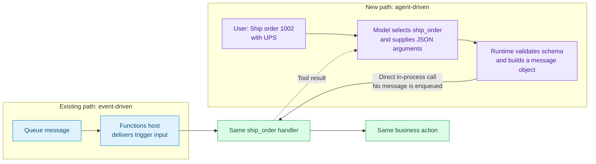

# Existing Functions. New agent-driven entry point.

**Reuse the same business logic. Keep existing triggers. Let an agent choose the next action.**

## 1. One function, two ways in



**Blue:** existing trigger path. **Purple:** new agent path. **Green:** reused logic.
The HTTP equivalent builds a FastAPI request object instead of sending an HTTP request.

## 2. What does the developer add?

On the runtime's enhanced app, keep the trigger and handler. Add **a tool
declaration, an input contract, and an intent description**.

```python
class ShipOrder(BaseModel):
    order_id: str
    carrier: str


@app.tool(schema=ShipOrder)  # New: expose this operation to agents.
@app.queue_trigger(arg_name="msg", queue_name="ship-orders", connection="AzureWebJobsStorage")
def ship_order(msg: func.QueueMessage) -> None:
    """Mark an order as shipped with the given carrier."""
    body = json.loads(msg.get_body())
    order = ORDERS.get(body["order_id"])
    if order is None:
        raise ValueError(f"Order {body['order_id']} not found")
    order["status"] = f"shipped via {body['carrier']}"
```

Excerpt from the [runnable sample](../samples/in-app-function-tools/src/function_app.py);
imports, app construction, and demo order data are omitted.
**A basic queue Function has no `@app.tool` or tool schema.**
This sample only simulates shipping in memory.

| Developer supplies | Purpose |
| --- | --- |
| Docstring | Tells the model **when and why** to call the tool. |
| `schema=ShipOrder` | Tells the model **which fields** to supply; the runtime validates them. |
| Existing handler | Owns **what the operation actually does**. |

Standalone functions can also use `@app.tool`; their typed parameters supply the schema.
Tools are available to all agents by default; `agents=[...]` and the existing
denylist can restrict access.

## 3. How does an agent use it?

Example request: **"Look up order 1002, ship it with UPS, and confirm its status."**

```mermaid
sequenceDiagram
    actor User
    participant Agent as Agent / model
    participant Runtime as Tool runtime
    participant Functions as Existing handlers
    User->>Agent: Look up, ship, and confirm order 1002
    Agent->>Runtime: get_order(order_id="1002")
    Runtime->>Functions: Build HTTP request; call get_order
    Functions-->>Agent: Status: pending (via runtime)
    Agent->>Runtime: ship_order(order_id="1002", carrier="UPS")
    Runtime->>Functions: Validate schema; build QueueMessage; call ship_order
    Functions-->>Agent: completed (via runtime; handler returned None)
    Agent->>Runtime: get_order(order_id="1002")
    Runtime->>Functions: Build HTTP request; call get_order
    Functions-->>Agent: Status: shipped via UPS (via runtime)
    Agent-->>User: Confirmed: shipped via UPS
```

The model requests tools; **the runtime executes the developer's code**.
The final lookup verifies state rather than treating `completed` as proof of a business outcome.

## 4. What changes versus a basic trigger?

| | Normal trigger invocation | Agent tool invocation |
| --- | --- | --- |
| Starts execution | An incoming HTTP request or broker message | A model-selected tool call |
| Supplies input | Functions host and bindings | Runtime-built input from validated JSON |
| Runs business logic | Existing handler | Same handler, directly in-process |
| Host / broker guarantees | Normal configured trigger semantics | No broker delivery, settlement, retries, or host-managed bindings |
| Authorization boundary | Existing HTTP ingress / broker access | Agent-facing access and tool permissions; not trigger ingress auth |

**Proven:** Python spike, real Core Tools HTTP/queue round-trip, and owner-confirmed
live model experiment. **Not production-ready:** supported binding contracts,
registration lifecycle, and broader coverage still need formal design review.

[Detailed summary and design decisions](in-app-function-tools-spike-summary.md)
