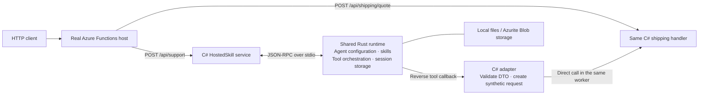
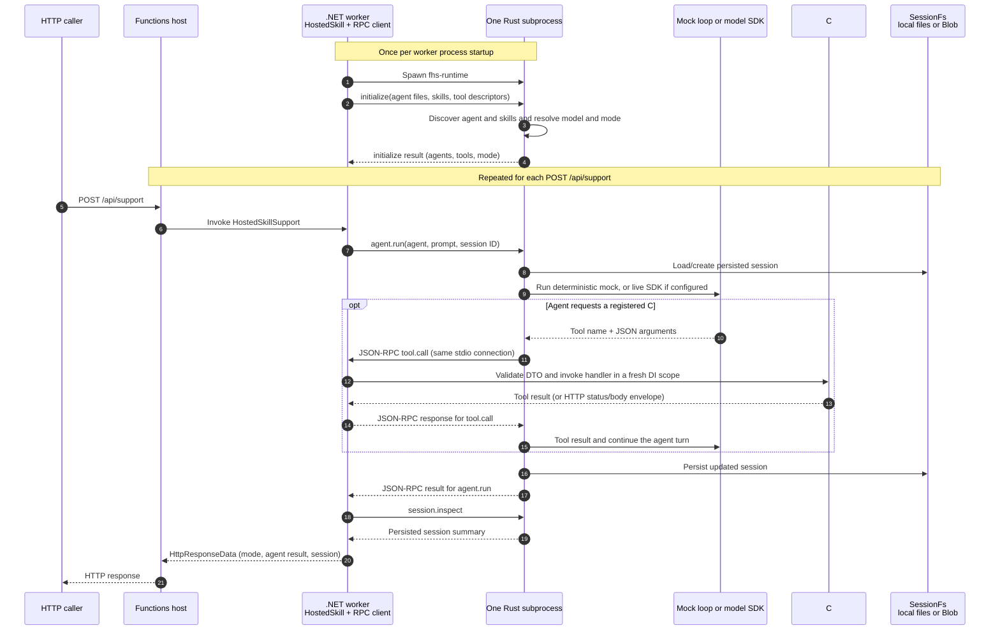
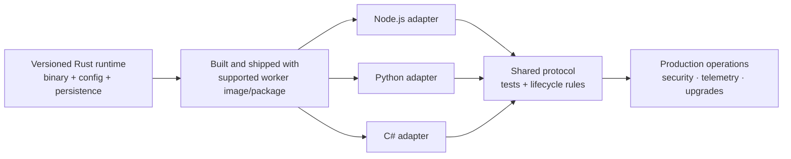

# One function. Two entry points. Shared Rust runtime.

**One C# function, two entry points:** HTTP and the agent call the same handler.
The demo uses mock inference by default and supports configured Foundry.

## What we built



## What happens on a HostedSkill run?

Each .NET worker starts one reusable Rust process. At startup, Rust loads the
agent, skills, and C# tool descriptors; each request then runs through that
initialized runtime.



JSON-RPC runs over shared bidirectional **stdin/stdout** pipes. Rust can call a
C# tool mid-run; C# invokes the handler in the same worker and returns its
status and body. Sessions persist across worker restarts.

## Authoring

```csharp
[Function("ShippingQuote")]
[AgentTool("calculate_shipping_http", "Calculate shipping.",
    InputType = typeof(ShippingRequest))]
public Task<HttpResponseData> ShippingQuoteAsync(...)
```

Register the function type once. The runtime generates the tool schema from
the DTO and invokes the same handler.

## What the demo demonstrates

The agent callback invokes the registered C# HTTP handler in-process with
synthetic request/response objects; external HTTP uses the real Functions host.
Configured Foundry support is implemented; live authentication and inference
are the next validation step.

**Run:** `python3 smoke_host.py --storage local` after setup. See the
[technical README](README.md) for prerequisites and Foundry configuration.

## Why Rust for the shared runtime?

One Rust runtime can provide shared orchestration to language workers over
JSON-RPC/stdio, while each worker keeps its own functions and tools. This demo
exercises .NET; Node.js and Python adapters are future work.

```text
Node.js worker ─┐
Python worker ──┼── same JSON-RPC-over-stdio contract ──> Rust agent runtime
C# worker ──────┘
```

The GitHub Copilot SDK has a Rust implementation that could be evaluated for
provider integration.

> **Also evaluate Go:** compare performance, distribution, ecosystem, and
> implementation effort before selecting the long-term runtime language.

## What it takes to productionize this approach

Productionizing the **Rust runtime + C# worker** means packaging the runtime,
adding language adapters, and defining shared compatibility and operations.



| Investment area | What needs to be built or decided |
| --- | --- |
| **Runtime + adapters** | Versioned binaries, packaging, and a thin process/tool adapter per language. |
| **Protocol + Functions** | Versioned messages, compatibility, trigger coverage, authorization, and result mapping. |
| **Quality + security** | Cross-language conformance tests, CI, identity, least privilege, and secret handling. |
| **Scale + operations** | Shared persistence, concurrency, telemetry, health, upgrades, and support ownership. |

The opportunity: implement orchestration once and keep language adapters
focused. A rollout estimate needs agreed language/trigger scope and support
requirements.
