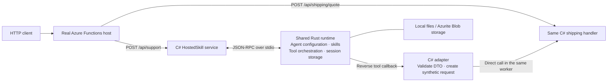
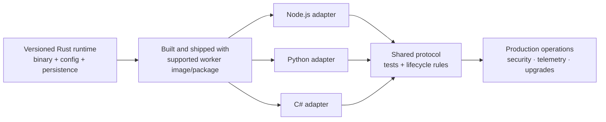

# One function. Two entry points. Shared Rust runtime.

**Working local prototype:** an existing C# HTTP function also serves as an
agent tool, without a second business implementation or app-authored adapter.
Inference uses deterministic MOCK by default and can attempt configured Foundry
inference; live service validation is separate from the mock evidence below.

## What we built



## What happens on a HostedSkill run?

**The worker does not start a new Rust process for each request.** When a .NET
Functions worker starts, its `RuntimeService` starts one Rust `fhs-runtime`
subprocess and keeps it for that worker's lifetime. Startup sends one
`initialize` message: Rust reads the copied agent configuration and skill files,
resolves inference mode, and receives the C# tool descriptors. Agent/tool
metadata is not reparsed for every request.

```mermaid
sequenceDiagram
    autonumber
    participant Caller as HTTP caller
    participant Host as Functions host
    participant CSharp as .NET worker<br/>HostedSkill + RPC client
    participant Rust as One Rust subprocess
    participant Model as Mock loop or model SDK
    participant Tool as C# function/tool handler
    participant Store as SessionFs<br/>local files or Blob

    Note over CSharp,Rust: Once per worker process startup
    CSharp->>Rust: Spawn fhs-runtime
    CSharp->>Rust: initialize(agent files, skills, tool descriptors)
    Rust->>Rust: Discover agent + skills; resolve model and mode
    Rust-->>CSharp: initialize result (agents, tools, mode)

    Note over Host,Store: Repeated for each POST /api/support
    Caller->>Host: POST /api/support
    Host->>CSharp: Invoke HostedSkillSupport
    CSharp->>Rust: agent.run(agent, prompt, session ID)
    Rust->>Store: Load/create persisted session
    Rust->>Model: Run deterministic mock, or live SDK if configured
    opt Agent requests a registered C# tool
        Model-->>Rust: Tool name + JSON arguments
        Rust->>CSharp: JSON-RPC tool.call (same stdio connection)
        CSharp->>Tool: Validate DTO; invoke handler in a fresh DI scope
        Tool-->>CSharp: Tool result (or HTTP status/body envelope)
        CSharp-->>Rust: JSON-RPC response for tool.call
        Rust->>Model: Tool result; continue the agent turn
    end
    Rust->>Store: Persist updated session
    Rust-->>CSharp: JSON-RPC result for agent.run
    CSharp->>Rust: session.inspect
    Rust-->>CSharp: Persisted session summary
    CSharp-->>Host: HttpResponseData (mode, agent result, session)
    Host-->>Caller: HTTP response
```

In the diagram, JSON-RPC requests and their responses share the same
bidirectional JSON-lines **stdin/stdout pipes**; `tool.call` is a reverse
request while the original `agent.run` is still in progress. The C# RPC
reader stays active and dispatches that callback, then writes its correlated
response so Rust can continue its model/tool loop.

For `calculate_shipping_http`, the callback calls `ShippingQuoteAsync` directly
inside the same .NET worker with synthetic HTTP request/response objects. It
does not loop back through the Functions host. The resulting HTTP
`status_code` and text `body` are tool output; the Rust agent run completes
after the model receives that output. Finally, the Rust `agent.run` response
becomes `AgentRunResult`, the HTTP function adds session inspection data, and
the Functions host returns the outer HTTP response.

Each scaled-out .NET worker process owns its own Rust subprocess. Within one
worker, agent runs are serialized to protect session files. A worker restart
starts a new Rust process; persisted session data lets a later run resume the
conversation.

| Building block | Demonstrated value |
| --- | --- |
| **Rust runtime** | Common agent orchestration and persistence live behind a language-neutral stdio protocol; C# retains its application logic. |
| **`[AgentTool]` attribute** | Mark the existing function handler as a tool and declare its input DTO. No separately authored shipping-tool adapter. |
| **Two entry points** | A real HTTP request and an agent-tool callback reach the same shipping method. |
| **Persistent sessions** | Conversations resume across turns and a complete host, worker, and Rust-process restart. |

## Why Rust for the shared runtime?

The goal is to keep agent orchestration in **one language-neutral runtime**
instead of reimplementing it separately for every Functions language worker.
Rust can run as a managed subprocess; a Node.js, Python, C#, or other worker
could communicate with it through the same bidirectional JSON-lines stdio
protocol. Each worker keeps its own language-native functions and tools, while
the shared runtime owns common agent execution, skill discovery, and session
handling.

```text
Node.js worker ─┐
Python worker ──┼── same JSON-RPC-over-stdio contract ──> Rust agent runtime
C# worker ──────┘
```

This boundary can make runtime behavior more consistent across languages and
lets the protocol be tested independently of a specific worker. For the sample,
the Rust-to-C# `tool.call` is a concrete example: Rust asks for a tool by name
and JSON arguments; the C# worker invokes its own handler and returns a result
over the same pipes.

**This is an architectural benefit the protocol is designed to enable, not a
claim that every language integration exists today.** This spike currently
demonstrates the Rust runtime with a .NET isolated worker. Node.js, Python, and
other language workers have not been implemented or validated here.

## What it takes to productionize this approach

The spike validates a **Rust runtime + one C# worker** locally. Making it a
supported multi-language capability takes investment in the runtime package,
one adapter per language worker, and the operations and compatibility contract
around them.



| Investment area | What needs to be built or decided |
| --- | --- |
| **Runtime distribution** | Build and publish versioned Rust binaries for each supported OS/CPU; include the compatible runtime dependencies; package them into the worker image or deployment artifact; define updates, rollback, and software-supply-chain scanning. |
| **Language adapters** | Implement and support a Node.js, Python, and C# wrapper for process startup, stdio framing, initialization, tool registration/callbacks, result mapping, cancellation, and shutdown. The spike contains only the C# adapter. |
| **Stable protocol** | Version and document JSON-RPC messages, schemas, errors, streaming, compatibility, and capability negotiation so independent adapters can interoperate with runtime upgrades. |
| **Functions behavior contract** | Define which triggers and handler signatures can be exposed as tools in each language, what execution bypasses, how authorization is enforced, and how HTTP/binding results map to agent-visible outcomes. Current direct-function adaptation covers only a bounded C# HTTP shape. |
| **Shared conformance tests** | Create language-neutral protocol fixtures and adapter conformance tests; add CI for each language, real-host integration, cancellation/crash behavior, and session persistence across restart and scale-out. |
| **Security and identity** | Set the trust boundary for prompts, tool arguments, skills, local files, and subprocess access; establish supported credential flows, least privilege, secret handling, and authorization policy for tool calls. |
| **Persistence and scale** | Select supported storage backends and identity mechanisms; define concurrent-session behavior, worker scaling, locking, retention, recovery, and cost expectations. Current sample serializes runs per worker and has incomplete production Blob identity support. |
| **Operations and support** | Add structured cross-process telemetry, health/readiness and diagnostics, timeouts/resource limits, failure policy, version inventory, incident ownership, and a documented support matrix. |

The main leverage is that **agent orchestration and protocol behavior can be
implemented once**, while each language adapter stays relatively thin and
language-native. That is a design goal, not a measured cost saving yet: adapter
work and ongoing compatibility testing still scale with each supported worker.
The prototype has not established production readiness or estimated delivery
effort; packaging, protocol guarantees, supported language/trigger scope, and
operational requirements need to be agreed before sizing a rollout.

## Small authoring change

```csharp
[Function("ShippingQuote")]
[AgentTool("calculate_shipping_http", "Calculate shipping.",
    InputType = typeof(ShippingRequest))]
public Task<HttpResponseData> ShippingQuoteAsync(
    [HttpTrigger(AuthorizationLevel.Anonymous, "post", Route = "shipping/quote")]
    HttpRequestData request,
    CancellationToken cancellationToken = default)
```

Register the function type once:
`registry.RegisterFunctions<ShippingFunctions>(provider)`.
The runtime generates the tool schema from the DTO and invokes the handler in a
fresh dependency-injection scope.

## Evidence: same handler, both paths

**Fresh local verification: October 27, 2026**, using a real `func host start`,
.NET 10 isolated worker, and Rust subprocess.

| Scenario | HTTP entry | Agent-tool entry |
| --- | --- | --- |
| Order `ORD-900`, ZIP `98052` | **200** · PriorityExpress · **$14.25** | **200** envelope · same carrier and rate |
| Empty ZIP | **400** · validation error | **400** envelope · same handler error |
| Execution evidence | `http-trigger` | `stdio-function-handler` |

```text
PASS  Real Functions trigger indexing and HTTP requests
PASS  Rust → C# callbacks for order lookup and shipping
PASS  HTTP status + text-body tool results, including errors
PASS  Second conversation turn and third turn after full restart
PASS  All 22 C# lifecycle / validation / adapter check groups
```

On October 28, 22 C# checks and 20 Rust tests passed. Mode-selection tests
confirmed mock-by-default behavior, Foundry-intent detection, and reporting the
initialized mode to the C# host. Local and Azurite HTTP smoke runs also passed
with explicit MOCK selection. The live service path was not exercised.

Fresh logs, responses, and `summary.json` are retained locally under
`.tools/leadership-validation-20261027-1912/` (ignored, not committed).
Earlier verification also passed the real-host scenario with Azurite storage.

## Scope, not a production claim

**Real host, real worker, real Rust process; deterministic mock inference
verified.** Configured Foundry inference is available, but this evidence does
not validate live authentication, model invocation, or a live model's tool
selection. The order/shipping data are fixed sample values.

Agent callbacks invoke the handler directly; they **do not** run Functions
middleware, HTTP ingress authorization, or binding orchestration.
Support is limited to the documented HTTP request/response signatures.
The prototype demonstrates the C# integration, not proven support for other
languages, arbitrary triggers, or production deployment packaging.

**Reproduce:** from this directory, run `python3 smoke_host.py --storage local`
after activating the prerequisites. See the [technical README](README.md) for
setup, manual HTTP requests, the error scenario, and limitations.
