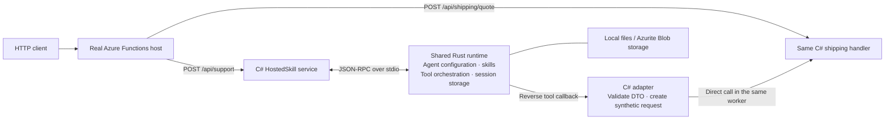

# One function. Two entry points. Shared Rust runtime.

**Working local prototype:** an existing C# HTTP function also serves as an
agent tool, without a second business implementation or app-authored adapter.
Inference uses deterministic MOCK by default and can attempt configured Foundry
inference; live service validation is separate from the mock evidence below.

## What we built



| Building block | Demonstrated value |
| --- | --- |
| **Rust runtime** | Common agent orchestration and persistence live behind a language-neutral stdio protocol; C# retains its application logic. |
| **`[AgentTool]` attribute** | Mark the existing function handler as a tool and declare its input DTO. No separately authored shipping-tool adapter. |
| **Two entry points** | A real HTTP request and an agent-tool callback reach the same shipping method. |
| **Persistent sessions** | Conversations resume across turns and a complete host, worker, and Rust-process restart. |

## Small authoring change

```csharp
[Function("ShippingQuote")]
[AgentTool("calculate_shipping_http", "Calculate shipping.",
    InputType = typeof(ShippingRequest))]
public Task<HttpResponseData> ShippingQuoteAsync(
    [HttpTrigger(AuthorizationLevel.Anonymous, "post", Route = "shipping/quote")]
    HttpRequestData request,
    CancellationToken cancellationToken = default)
```

Register the function type once:
`registry.RegisterFunctions<ShippingFunctions>(provider)`.
The runtime generates the tool schema from the DTO and invokes the handler in a
fresh dependency-injection scope.

## Evidence: same handler, both paths

**Fresh local verification: October 27, 2026**, using a real `func host start`,
.NET 10 isolated worker, and Rust subprocess.

| Scenario | HTTP entry | Agent-tool entry |
| --- | --- | --- |
| Order `ORD-900`, ZIP `98052` | **200** · PriorityExpress · **$14.25** | **200** envelope · same carrier and rate |
| Empty ZIP | **400** · validation error | **400** envelope · same handler error |
| Execution evidence | `http-trigger` | `stdio-function-handler` |

```text
PASS  Real Functions trigger indexing and HTTP requests
PASS  Rust → C# callbacks for order lookup and shipping
PASS  HTTP status + text-body tool results, including errors
PASS  Second conversation turn and third turn after full restart
PASS  All 22 C# lifecycle / validation / adapter check groups
```

On October 28, 22 C# checks and 20 Rust tests passed. Mode-selection tests
confirmed mock-by-default behavior, Foundry-intent detection, and reporting the
initialized mode to the C# host. Local and Azurite HTTP smoke runs also passed
with explicit MOCK selection. The live service path was not exercised.

Fresh logs, responses, and `summary.json` are retained locally under
`.tools/leadership-validation-20261027-1912/` (ignored, not committed).
Earlier verification also passed the real-host scenario with Azurite storage.

## Scope, not a production claim

**Real host, real worker, real Rust process; deterministic mock inference
verified.** Configured Foundry inference is available, but this evidence does
not validate live authentication, model invocation, or a live model's tool
selection. The order/shipping data are fixed sample values.

Agent callbacks invoke the handler directly; they **do not** run Functions
middleware, HTTP ingress authorization, or binding orchestration.
Support is limited to the documented HTTP request/response signatures.
The prototype demonstrates the C# integration, not proven support for other
languages, arbitrary triggers, or production deployment packaging.

**Reproduce:** from this directory, run `python3 smoke_host.py --storage local`
after activating the prerequisites. See the [technical README](README.md) for
setup, manual HTTP requests, the error scenario, and limitations.
