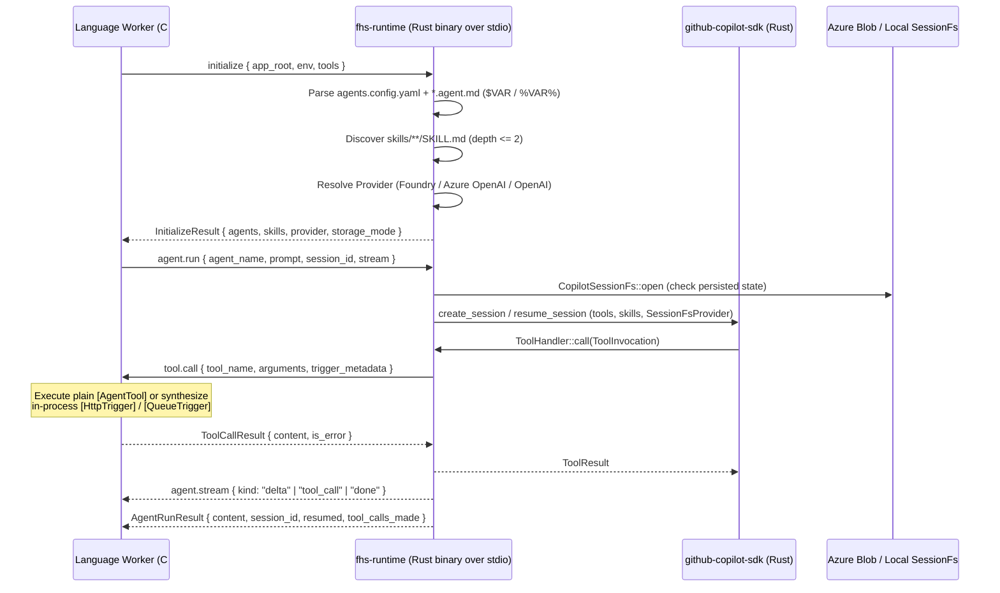

# Cross-Language Rust Runtime Spike (`fhs-runtime`)

This spike validates a **single shared Rust runtime** (`fhs-runtime`) built on [`github-copilot-sdk`](https://crates.io/crates/github-copilot-sdk) that communicates with any Azure Functions language worker (C#, Python, Node/TypeScript, Java) over **bi-directional stdio JSON-RPC 2.0**.

---

## 1. Architecture Overview



---

## 2. What Is Implemented in This Spike

### Rust Runtime (`spikes/rust-runtime/src/`)
- **`env.rs` & `config.rs`**: Parses `agents.config.yaml` and `*.agent.md` / `agent.md` / `CLAUDE.md` (at root and `agents/`), performing `$VAR` and `%VAR%` environment variable substitution (with `$$VAR` / `%%VAR%%` escaping and fenced code-block exclusion in markdown bodies).
- **`skills.rs`**: Discovers `skills/**/SKILL.md` up to depth 2 without descending inside a skill root, and applies per-agent `skills:` allowlist/boolean filters.
- **`providers.rs`**: Resolves `Foundry`, `AzureOpenAI`, and `OpenAI` providers from environment variables (`AZURE_FUNCTIONS_AGENTS_PROVIDER`, `FOUNDRY_PROJECT_ENDPOINT`, `AZURE_OPENAI_ENDPOINT`, `OPENAI_API_KEY`), validates HTTPS endpoint shapes, and builds `github_copilot_sdk::types::ProviderConfig` with `BearerTokenProvider` (Managed Identity / Azure CLI / static token) or API keys.
- **`session_fs.rs`**: Implements `github_copilot_sdk::session_fs::SessionFsProvider` backed by:
  - **`BlobSessionBackend`**: Azure Blob Storage (`AzureWebJobsStorage` connection string / `UseDevelopmentStorage=true` or `AzureWebJobsStorage__blobServiceUri`) with `SharedKey` HMAC-SHA256 signing, `x-ms-meta-hdi_isfolder: true` directory markers, and read-only approved skill file pass-through.
  - **`LocalSessionBackend`**: Sandboxed local fallback under `.azure-functions-agents/copilot-native/{agent}/{session_id}`.
- **`protocol.rs` & `engine.rs`**: Multiplexed bi-directional JSON-RPC 2.0 server over `stdin`/`stdout`. While `agent.run` is in-flight, the runtime dispatches reverse `tool.call` RPC requests and `agent.stream` notifications back to the language worker without head-of-line blocking.

### C# Prototype (`spikes/rust-runtime/dotnet/HostedSkills.Spike/`)
- **`[HostedSkillInput("...")] HostedSkill`**: Exposes `RunAsync` and `StreamAsync` (`IAsyncEnumerable<AgentStreamEvent>`) over `HostedSkillRuntimeClient`.
- **`[AgentTool]` & `AgentToolRegistry`**:
  - Supports plain C# methods (`LookupOrder(string orderId)`) with automatic JSON Schema generation.
  - Supports **in-app Azure Functions triggers** (`[AgentTool]` + `[HttpTrigger]`) by synthesizing `SynthesizedHttpRequestData` in-process when `fhs-runtime` sends a `tool.call` over stdio — zero HTTP loopback required.

---

## 3. Running the Spike

```bash
# 1. Run Rust unit + stdio/Blob e2e tests
cd spikes/rust-runtime
cargo test

# 2. Build the Rust binary and run the C# HostedSkill + in-app tool prototype
cargo build --bin fhs-runtime
cd dotnet/HostedSkills.Spike
dotnet run
```

---

## 4. Is This Worth Pursuing? Feasibility & Gaps Analysis

### Why It Is Worth Pursuing
1. **Single source of truth for agent semantics**: `.agent.md` parsing, `$VAR` substitution rules, `skills/` discovery, `SessionFs` path sandboxing, Azure Blob persistence layout (`copilot-native/{agent}/{session}`), and provider auth rules are implemented once in Rust instead of being re-implemented (and drifting) across Python, C#, TypeScript, and Java.
2. **Natural fit for In-App Tools over stdio**: Keeping tool/trigger execution in the language worker (`tool.call` reverse RPC over stdio) lets C#/Python/Node code use native DI, bindings, and in-process trigger synthesis (`HttpRequestData`, etc.) while Rust owns the LLM agent loop.
3. **Zero runtime dependencies for host languages**: `fhs-runtime` compiles to a single native binary per platform (`win-x64`, `linux-x64`, `osx-arm64`) that can be bundled inside NuGet (`runtimes/{rid}/native/`), PyPI wheels, or npm packages.

### Gaps & Things to Address for Production
1. **Underlying Copilot CLI Binary Bundling**:
   - `github-copilot-sdk` in Rust talks to the native Copilot agent runtime (`copilot --server --stdio` or `libcopilot` via `in-process` FFI). Packaging for Azure Functions must either bundle the `in-process` native library or ensure the CLI binary is included in the platform-specific NuGet/wheel package.
2. **Concurrency & Multiplexing Across Parallel Function Invocations**:
   - A single Azure Functions language worker process handles many concurrent function invocations. The stdio JSON-RPC channel already multiplexes by `id` (and `session_id` on `agent.stream` notifications), so **one `fhs-runtime` process per worker** can serve concurrent `HostedSkill.RunAsync` calls, provided `agent.stream` notifications are routed by `(request_id, session_id)`.
3. **Response Schema Validation (`response_schema` / `response_example`)**:
   - In Python, `HostedSkill` validates structured JSON output against `response_schema` and appends formatting instructions. Moving this into `fhs-runtime` (or using `Session::send_and_wait_structured`) gives every language worker structured output validation for free.
4. **MCP Server Auth & Dynamic Headers (`mcp.json`)**:
   - Discovery of `mcp.json` and Entra token acquisition for authenticated MCP servers should live in `fhs-runtime` alongside `skills/` discovery so language workers don't have to manage MCP config.
5. **Distributed Tracing (OpenTelemetry W3C TraceContext)**:
   - `agent.run` and reverse `tool.call` messages should carry `traceparent` / `tracestate` (which `github-copilot-sdk` natively supports on `MessageOptions` and `ToolInvocation`) so Application Insights traces connect the C# function invocation, the Rust agent turn, and the reverse C# tool execution into a single distributed trace.
6. **Process Lifecycle & Crash Recovery**:
   - `HostedSkillRuntimeClient` in C# (registered as a singleton `IHostedService` in the Functions isolated worker) should supervise `fhs-runtime`, automatically restarting and re-sending `initialize` if the subprocess ever exits unexpectedly.
